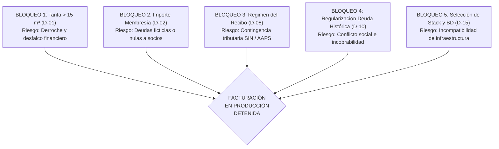

# PARTE F. LISTA DE COMPROBACIÓN PARA LA APROBACIÓN INSTITUCIONAL Y RESUMEN DE BLOQUEOS

## F.1. Lista de Comprobación (Checklist) para el Directorio y la Asamblea

La siguiente lista de comprobación debe ser completada y suscrita por la Directiva de la Organización y el Comité de Fiscalización antes de iniciar la Fase 3 (Desarrollo del Motor de Consumo) y la puesta en marcha de la facturación en producción:

| Código | Decisión a Ratificar | Opciones Sometidas a Aprobación | Órgano Competente | Estado de Aprobación | Firma / Ref. Acta |
| :---: | :--- | :--- | :--- | :---: | :--- |
| **D-01** | **Estructura Tarifaria Definitiva (> 15 m³)** | [ ] Mantener reducción a Bs 20 (fuente) [ ] Tarifa incremental AAPS (Bs 27 + excedente) [ ] Tarifa lineal continua (Bs 15 + Bs 2/m³) | Asamblea General de Socios | **PENDIENTE (BLOQUEANTE)** | ____________________ |
| **D-02** | **Importe Oficial de Membresía** | [ ] Monto fijo estándar: Bs ______ [ ] Exención formal a socios fundadores migrados [ ] Arancel diferenciado para traspasos | Asamblea General / Directorio | **PENDIENTE (BLOQUEANTE)** | ____________________ |
| **D-03** | **Día Fijo de Vencimiento Mensual** | [ ] Día 15 de cada mes [ ] Día 20 de cada mes [ ] Último día calendario del mes | Directorio Institucional | **PENDIENTE** | ____________________ |
| **D-04** | **Modalidad de Emisión de Facturación** | [ ] Manual por lote con confirmación administrativa [ ] Tarea programada automática (*cron*) | Administrador General | **PENDIENTE** | ____________________ |
| **D-05** | **Políticas de Cobro en Caja y Prelación** | [ ] Prelación obligatoria de deuda más antigua (FIFO) [ ] Selección libre de obligaciones por el socio | Directorio / Tesorería | **PENDIENTE** | ____________________ |
| **D-06** | **Régimen de Descuentos y Anulaciones** | [ ] Descuento 20% Adulto Mayor (Ley boliviana) [ ] Anulación solo en mismo turno de caja con supervisor | Directorio / Asesor Legal | **PENDIENTE** | ____________________ |
| **D-07** | **Reglas para Medidores no Leídos y Rollover**| [ ] Cobro de cuota básica mínima (9 m³ = Bs 15) [ ] Promedio de últimos 3 meses (estándar AAPS) | Responsable de Lecturas | **PENDIENTE** | ____________________ |
| **D-08** | **Naturaleza Legal del Recibo** | [ ] Recibo Oficial Comunitario Interno (Exento) [ ] Facturación Electrónica en Línea SIAT (SIN) | Asesor Contable / Legal | **PENDIENTE (BLOQUEANTE)** | ____________________ |
| **D-09** | **Límite Temporal de Migración Histórica** | [ ] Últimos 12 meses operativos [ ] Últimos 24 meses [ ] Todo el archivo físico disponible | Comisión de Transcripción | **PENDIENTE** | ____________________ |
| **D-10** | **Activación de Deudas Históricas** | [ ] Acta individual de conciliación firmada por socio [ ] Aprobación de nómina de cartera por Directorio | Directorio / Asamblea | **PENDIENTE (BLOQUEANTE)** | ____________________ |
| **D-11** | **Modelo Socio-Predio-Medidor** | [ ] Modelo integral desacoplado (Recomendado) [ ] Modelo simplificado directo (Socio-Medidor) | Arquitecto de Software | **PENDIENTE** | ____________________ |
| **D-12** | **Modelo de Tenencia y Servidor** | [ ] Instancia única independiente (*Single-Tenant*) [ ] Plataforma SaaS multi-institución (*Multi-Tenant*) | Directorio / Financiador | **PENDIENTE** | ____________________ |
| **D-13** | **Enrolamiento al Portal del Socio** | [ ] Talón impreso en ventanilla con clave temporal [ ] Enlace de autoservicio digital por correo/SMS | Administración | **PENDIENTE** | ____________________ |
| **D-14** | **Gestión de Turnos y Arqueo de Caja** | [ ] Turnos obligatorios con arqueo ciego diario [ ] Cobranza abierta continua fechada | Responsable de Caja | **PENDIENTE** | ____________________ |
| **D-15** | **Selección Definitiva del Stack** | [ ] Stack A: Python/Django + PostgreSQL [ ] Stack B: TypeScript/Node.js + PostgreSQL [ ] Stack C: PHP/Laravel + MariaDB | Equipo Técnico / Arquitecto | **PENDIENTE (BLOQUEANTE)** | ____________________ |
| **D-16** | **Método de Captura de Lecturas** | [ ] Web responsive PWA móvil con foto de respaldo [ ] Planilla impresa manual tradicional en papel | Responsable de Lecturas | **PENDIENTE** | ____________________ |
| **D-17** | **Catálogo Oficial de Servicios Autorizados** | [ ] Exclusivamente Agua y Membresía [ ] Agua, Membresía, Reconexión y Aseo Comunal | Directorio Institucional | **PENDIENTE** | ____________________ |
| **D-18** | **Precisión de Medidores y Redondeo** | [ ] Enteros de $m^3$ y cálculo con 2 decimales en Bs [ ] Registro de fracciones decimales de $m^3$ | Responsable de Lecturas | **PENDIENTE** | ____________________ |
| **D-19** | **Custodia y Protección del Padrón** | [ ] Exportación protegida con marca de agua y auditoría [ ] Exportación libre para usuarios administrativos | Directorio / Asesor Legal | **PENDIENTE** | ____________________ |
| **D-20** | **Dimensionamiento de Capacidad** | [ ] Escala Pequeña (hasta 1,000 socios, 1 cajero) [ ] Escala Mediana (hasta 5,000 socios, 3 cajeros) | Administración | **PENDIENTE** | ____________________ |

---

## F.2. Resumen Ejecutivo de Bloqueos Críticos Previos a la Facturación Real

Para resguardar la responsabilidad jurídica, financiera y comunitaria del equipo de ingeniería y de la propia Directiva de la Organización, se declaran los siguientes **CINCO BLOQUEOS CRÍTICOS ABSOLUTOS (SHOWSTOPPERS)**. El sistema podrá ser configurado y probado en entornos de laboratorio o preproducción, pero **QUEDA ESTRICTAMENTE PROHIBIDO EL COBRO DE DINERO REAL Y LA EMISIÓN DE RECIBOS DEFINITIVOS** mientras los siguientes puntos no cuenten con una resolución institucional escrita y firmada:

1.  **Bloqueo Crítico 1 (D-01 - Anomalía Tarifaria de 15 m³ a 16 m³):**
    *   *Razón del Bloqueo:* La regla fuente que reduce el cobro de Bs 27 a Bs 20 para consumos mayores a 15 m³ premia el derroche de agua y desfinancia a la institución. No puede programarse un algoritmo de cobro en producción con una curva tarifaria no monótona sin un acta expresa de la Asamblea que asuma formalmente dicha política.
2.  **Bloqueo Crítico 2 (D-02 - Cuantía y Exenciones de Membresía):**
    *   *Razón del Bloqueo:* No existe importe fijado en la fuente. Si no se aprueba el monto y la regla de exención para los socios fundadores migrados, el alta de socios generará obligaciones económicas indeterminadas o deudas injustificadas a familias que ya pagaron su acción hace décadas.
3.  **Bloqueo Crítico 3 (D-08 - Naturaleza Legal y Fiscal del Recibo Oficial):**
    *   *Razón del Bloqueo:* Si la entidad emite recibos oficiales comunitarios sin validar su condición tributaria ante el Servicio de Impuestos Nacionales (SIN), podría incurrir en sanciones por evasión fiscal o incumplimiento de deberes formales si correspondía facturación electrónica SIAT.
4.  **Bloqueo Crítico 4 (D-10 - Protocolo de Aprobación de Cartera Deudora Histórica):**
    *   *Razón del Bloqueo:* Cobrar deudas pasadas transcritas desde cuadernos viejos sin una asamblea previa de conciliación generará controversias comunitarias, impugnaciones y rechazo al nuevo sistema.
5.  **Bloqueo Crítico 5 (D-15 - Ratificación del Stack de Persistencia y Seguridad):**
    *   *Razón del Bloqueo:* El inicio del desarrollo de la Fase 1 requiere ratificar formalmente la base de datos relacional y el framework que garanticen el aislamiento ACID y la disponibilidad operativa en el entorno de la organización.

---

## F.3. Acta de Presentación y Estado del Documento

El presente documento, titulado **CONSTITUCIÓN DEL PROYECTO (SDD v1.0) PARA EL SISTEMA DE ADMINISTRACIÓN, CONSUMO Y COBRO DE AGUA POTABLE (SisAgua)**, ha sido emitido como borrador arquitectónico normativo formal. 

**Estado:** `BORRADOR NORMATIVO INICIAL PARA REVISIÓN Y RATIFICACIÓN INSTITUCIONAL`  
**Autoría Técnica:** Especialista en Arquitectura de Software Sénior y Spec-Driven Development (SDD)  
**Fecha de Entrega:** 28 de Octubre de 2026  

---
*Fin del Documento Constitucional SDD v1.0*
