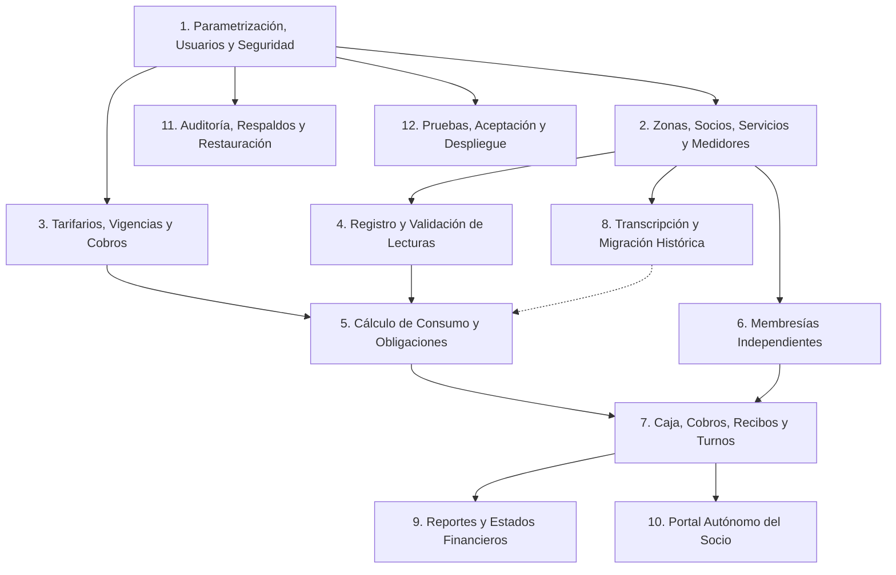
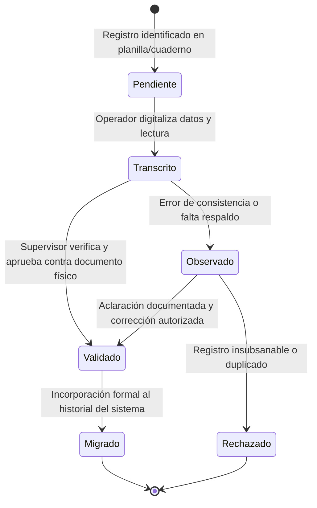
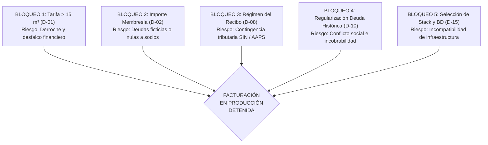

# SISTEMA DE ADMINISTRACIÓN, CONSUMO Y COBRO DE AGUA POTABLE (SisAgua)
## CONSTITUCIÓN NORMATIVA DEL PROYECTO (SDD - Spec-Driven Development)
### Versión 1.0 — Documento Rector de Arquitectura, Dominio y Gobernanza

| Metadato | Detalle Normativo |
| :--- | :--- |
| **Proyecto** | SisAgua — Sistema de Administración, Consumo y Cobro de Agua Potable |
| **Documento** | Constitución Normativa SDD (Fase 1: Normativa y Principios) |
| **Versión** | 1.0 (Borrador Arquitectónico Oficial para Ratificación Institucional) |
| **Fecha de Emisión** | Octubre 2026 |
| **Estado Normativo** | **PROPUESTA ARQUITECTÓNICA EN REVISIÓN** (Requiere ratificación de Directorio/Asamblea) |
| **Fuente Primaria** | Documento *“SISTEMA DE ADMINISTRACIÓN.docx”* (40 págs., 18 secciones, 882 párrafos) |
| **Contexto Jurisdiccional** | Estado Plurinacional de Bolivia (Marco normativo Ley 2066 / AAPS) |
| **Moneda Base** | Bolivianos (Bs) |
| **Zona Horaria y Convención** | UTC-4 (BOT - Bolivia Time) / Formato de Fechas: `DD/MM/AAAA` |
| **Clasificación de Requisitos** | **[A]** Requisito Explícito | **[B]** Principio Derivado | **[C]** Mejora Propuesta | **[D]** Decisión Pendiente |

---

> ### NOTA DE ADVERTENCIA Y CONDICIÓN DE BLOQUEO PREVIO A PRODUCCIÓN
> Esta Constitución establece los fundamentos innegociables de arquitectura, reglas de negocio e integridad financiera. **NO AUTORIZA LA IMPLEMENTACIÓN DE CÓDIGO PRODUCTIVO NI LA EMISIÓN DE OBLIGACIONES ECONÓMICAS REALES** hasta que la organización resuelva formalmente las Decisiones Pendientes Bloqueantes (especialmente **D-01: Tarifa definitiva y anomalía > 15 m³** y **D-02: Importe de membresía**).

---


# PARTE A. RESUMEN DEL ANÁLISIS DOCUMENTAL, CONTRADICCIONES, VACÍOS Y RIESGOS DE NEGOCIO

## A.1. Alcance y Metodología del Análisis Documental

El presente análisis arquitectónico se fundamenta en la lectura y evaluación exhaustiva, de principio a fin, del documento rector primario **“SISTEMA DE ADMINISTRACIÓN.docx”**, el cual consta de 40 páginas, 18 secciones temáticas y 882 párrafos normativos y descriptivos. Dicho documento condensa las reglas operativas, necesidades de gestión, dinámicas de cobro y flujos de información de comités, cooperativas, asociaciones u organizaciones comunitarias prestadoras de servicios de agua potable en el contexto boliviano.

Para garantizar el cumplimiento de los estándares de **Spec-Driven Development (SDD)**, cada enunciado, directriz y expectativa del documento ha sido descompuesto y catalogado bajo la siguiente taxonomía normativa:

*   **[A] Requisito Explícito:** Mandato definido de forma directa e inequívoca en el texto fuente, respaldado por una o más secciones específicas.
*   **[B] Principio Derivado:** Consecuencia técnica, arquitectónica o lógica indispensable para hacer viable un requisito explícito garantizando integridad referencial, seguridad, atomicidad transaccional y coherencia del sistema.
*   **[C] Mejora Propuesta:** Recomendación técnica y funcional basada en la ingeniería de software moderna y en el benchmark de sistemas equivalentes de agua potable (rurales, periurbanos y cooperativos), orientada a optimizar la robustez y escalabilidad.
*   **[D] Decisión Pendiente:** Punto ambiguo, contradictorio, incompleto o contingente que requiere definición, validación o ratificación formal por parte de los órganos de gobierno de la organización (Directorio o Asamblea General) antes de pasar a fases de especificación detallada o desarrollo.

---

## A.2. Hallazgos Críticos, Contradicciones y Vacíos Detectados

### 1. Hallazgo Crítico: Discontinuidad y Curva No Monótona en la Tarifa de Agua Potable
*   **Ubicación en Fuente:** Sección 2.1 (P20 a P48), Sección 5.3 (P266 a P281), Sección 17 (P863 a P877).
*   **Regla Explícita Original:** La fuente establece la siguiente estructura tarifaria por consumo mensual $c$ (en $\text{m}^3$):
    $$\begin{cases} 
    T(c) = 15 \text{ Bs}, & \text{si } 0 \le c \le 9 \\
    T(c) = 15 + 2(c - 9) \text{ Bs}, & \text{si } 9 < c \le 15 \\
    T(c) = 20 \text{ Bs}, & \text{si } c > 15 
    \end{cases}$$
*   **Tabla Numérica de Frontera:**
    *   $9 \text{ m}^3 \rightarrow 15 \text{ Bs}$
    *   $10 \text{ m}^3 \rightarrow 15 + 1 \times 2 = 17 \text{ Bs}$
    *   $12 \text{ m}^3 \rightarrow 15 + 3 \times 2 = 21 \text{ Bs}$
    *   $14 \text{ m}^3 \rightarrow 15 + 5 \times 2 = 25 \text{ Bs}$
    *   $15 \text{ m}^3 \rightarrow 15 + 6 \times 2 = 27 \text{ Bs}$
    *   $16 \text{ m}^3 \rightarrow 20 \text{ Bs}$ (*Tarifa especial total plana*)
    *   $30 \text{ m}^3 \rightarrow 20 \text{ Bs}$
*   **Análisis del Impacto y Riesgos:**
    1.  *Anomalía Matemática y Financiera:* La función de cobro no es monótona creciente. En el punto de discontinuidad $c = 15 \text{ m}^3$, un incremento marginal de $1 \text{ m}^3$ provoca una disminución neta de $7 \text{ Bs}$ ($-25.9\%$) en el valor facturado.
    2.  *Riesgo Moral e Incentivo Perverso:* Un socio con un consumo de $14 \text{ m}^3$ (Bs 25) o $15 \text{ m}^3$ (Bs 27) tiene un incentivo económico directo para abrir los grifos y desperdiciar intencionalmente agua hasta superar los $15 \text{ m}^3$, con el fin de pagar únicamente Bs 20. Esto contraviene la política nacional de preservación del recurso hídrico (Ley 2066 y directrices AAPS).
    3.  *Desfinanciamiento Operativo:* Los mayores consumidores (familias numerosas, negocios barriales o talleres) pagan menos que un consumidor moderado de $12 \text{ m}^3$ (Bs 21), generando una asimetría insostenible para el balance de caja del comité.
*   **Tratamiento SDD:** El documento fuente advierte explícitamente: *“Es una reducción deliberada conforme a la interpretación adoptada, pero debe ser aprobada expresamente por la organización. Si no se pretende esta reducción, será necesario definir otra tarifa antes de implementar el cálculo automático.”* En apego al principio de **Fidelidad de Negocio (P1)**, el sistema **no alterará unilateralmente esta fórmula**, pero **se clasifica como DECISIÓN BLOQUEANTE (D-01)**. Se prohíbe el despliegue de facturación productiva mientras el Directorio no ratifique si mantiene esta reducción deliberada o adopta una estructura de tramos marginales estándar.

---

### 2. Hallazgo: Ambigüedad en el Modelo de Dominio de Socios, Inmuebles, Cuentas y Medidores
*   **Ubicación en Fuente:** Sección 1 (P3), Sección 2.5 (P72 a P76), Sección 5.2 (P238 a P265), Sección 6.1 a 6.7 (P283 a P372).
*   **Problema Detectado:** El documento fuente utiliza de manera intercambiable las expresiones “socio o contrato”, “medidores asignados al socio”, “inmueble del socio” y “asignar un medidor a dos contratos activos incompatibles”. 
*   **Vacío Estructural:** No se formaliza si la titularidad del medidor recae sobre la persona física (Socio) o sobre la unidad catastral (Inmueble/Predio). En la realidad operativa boliviana:
    *   Un socio puede poseer múltiples inmuebles en diferentes sectores de la zona.
    *   Un predio puede transferirse a un nuevo propietario sin retirar el medidor instalado.
    *   Un socio inactivo o retirado puede mantener deudas pendientes que no deben imputarse al nuevo poseedor del inmueble salvo subrogación expresa.
*   **Consecuencia Arquitectónica:** Si no se independizan las entidades, una reasignación de medidor podría corromper la trazabilidad histórica de lecturas y deudas.
*   **Tratamiento SDD:** Se formaliza como **Principio Derivado [B]** la separación estricta del modelo en cuatro entidades: **Socio (Persona)**, **Predio/Inmueble (Ubicación)**, **Cuenta/Contrato de Servicio (Vínculo Jurídico)** e **Instrumento de Medición (Activo Físico)**. Catalogado como **Decisión Pendiente D-11**.

---

### 3. Hallazgo: Vacío en la Definición, Importe y Ciclo de Vida de la Membresía
*   **Ubicación en Fuente:** Sección 2.6 (P77 a P89), Sección 5.1 (P216 a P237), Sección 6.3 (P322 a P335), Sección 17 (P863 a P877).
*   **Problema Detectado:** El documento indica que al crear un socio nuevo se generará automáticamente una obligación por concepto de "Membresía", pero señala textualmente: *“El importe de la membresía deberá ser configurable, puesto que todavía no se ha especificado su monto.”*
*   **Vacíos Operativos:**
    1.  *Monto no definido:* No existe un valor monetario base establecido.
    2.  *Conflicto en la Migración Histórica:* Al transcribir y registrar a los socios fundadores o históricos de hace 5, 10 o 20 años, ¿se les debe generar automáticamente una membresía pendiente, o se asume cancelada bajo una figura de migración de derechos adquiridos?
    3.  *Transferencias y Reactivaciones:* No se detalla si un socio suspendido o reactivado vuelve a pagar membresía, ni cómo se maneja la transferencia mortis causa o compraventa de acciones de agua.
*   **Tratamiento SDD:** Catalogado como **Decisión Bloqueante D-02**. No podrá liberarse la creación productiva de socios ni la migración de padrón sin la aprobación formal de la política de membresías históricas y activas.

---

### 4. Hallazgo: Rigidez en la Prohibición de Pagos Parciales vs. Realidad de Cobranza
*   **Ubicación en Fuente:** Sección 2.4 (P67 a P71), Sección 9.2 (P567 a P578), Sección 9.3 (P579 a P596).
*   **Regla Explícita Original:** *“No se permitirán pagos parciales. El sistema únicamente aceptará el pago total de una obligación o de un conjunto de obligaciones seleccionadas... No se deberá registrar un pago por un monto inferior al total de las obligaciones seleccionadas ni permitir que un recibo quede parcialmente pagado.”*
*   **Problema y Consecuencias:**
    *   La regla protege la simplicidad contable y la cuadratura estricta del recibo, evitando cuentas corrientes complejas de saldos a favor o abonos fraccionados en el MVP.
    *   Sin embargo, en comunidades de escasos recursos económicos, si un socio acumula una deuda de 4 meses (Bs 108) y solo dispone de Bs 50 en ventanilla, no se le puede recibir abono a cuenta de una obligación individual. 
    *   La fuente sí permite que, si debe 4 obligaciones independientes, el cajero seleccione pagar 1 o 2 completas. No obstante, **no establece una regla de prelación cronológica obligatoria**. Esto abre el riesgo de que un socio pague la obligación del mes en curso y deje las deudas más antiguas acumulando riesgo de prescripción o incobrabilidad.
*   **Tratamiento SDD:** Se mantiene la prohibición estricta de pagos parciales sobre una obligación como **Requisito Explícito [A]**. Se plantea como **Decisión Pendiente D-05** establecer si el sistema debe forzar obligatoriamente la regla FIFO (cancelar primero las obligaciones vencidas más antiguas).

---

### 5. Hallazgo: Riesgo de Contaminación Financiera en la Transcripción de Datos Históricos
*   **Ubicación en Fuente:** Sección 8 (P444 a P548), Sección 10.7 (P710 a P723), Sección 13 (P771 a P784).
*   **Regla Cardinal de la Fuente:** *“La transcripción de una lectura histórica no deberá generar automáticamente una deuda exigible sin una revisión previa.”* Asimismo, la fuente advierte que debe distinguirse con claridad entre el *importe calculado* mediante tarifas teóricas y el *importe histórico documentado* registrado en planillas o cuadernos físicos.
*   **Riesgo Operativo:** En muchos comités de agua, los cobros históricos se realizaban mediante cuotas fijas extraordinarias, sanciones anotadas al margen o tarifas que cambiaron sin respaldo documental claro. Forzar un recálculo automatizado retroactivo generaría discrepancias financieras y conflictos sociales con los socios.
*   **Tratamiento SDD:** Se adopta como mandato constitucional el **doble carril**: el carril volumétrico de lectura histórica (para curvas de consumo) y el carril de regularización de deuda exigible (que requiere acta, validación, justificación documental y autorización expresa). Catalogado como **Decisión Pendiente D-09 y D-10**.

---

### 6. Hallazgo: Ausencia de Definición Tributaria y Formalidad del Recibo
*   **Ubicación en Fuente:** Sección 3.2 (P136 a P148), Sección 9.4 (P597 a P613), Sección 17 (P863 a P877).
*   **Problema Detectado:** La fuente define exhaustivamente el "Recibo de Pago", pero deja abierta la "Identificación tributaria, cuando aplique" y menciona "requisitos de factura fiscal".
*   **Contexto Normativo Boliviano:** 
    *   Los Comités de Agua Potable y Saneamiento (CAPYS) comunitarios y cooperativas de servicios públicos en áreas periurbanas/rurales suelen estar regulados bajo la Ley N° 2066 y la AAPS, operando frecuentemente sin ánimo de lucro mediante "Recibos Oficiales de Cobranza".
    *   Otras organizaciones pueden contar con Número de Identificación Tributaria (NIT) y estar obligadas al Sistema de Facturación Electrónica en Línea (SIAT) del Servicio de Impuestos Nacionales (SIN).
*   **Tratamiento SDD:** La Constitución define que el sistema emitirá de forma nativa e inviolable el **Recibo Interno Oficial de Cobranza**. Cualquier integración fiscal con el SIAT se mantendrá estrictamente como una opción fuera del alcance del MVP hasta su confirmación institucional (**Decisión D-08**).

---

### 7. Hallazgo: Conflicto de Seguridad en Credenciales y Accesos al Portal
*   **Ubicación en Fuente:** Sección 12.1 a 12.3 (P741 a P770).
*   **Problema Detectado:** El documento fuente descarta de manera terminante una propuesta inicial de utilizar el Documento de Identidad (CI) como contraseña permanente, advirtiendo sobre su alta vulnerabilidad.
*   **Tratamiento SDD:** Se acoge como **Principio Constitucional de Seguridad por Defecto (P7)** la obligatoriedad de hashes criptográficos robustos, prohibiendo el CI como contraseña definitiva y exigiendo contraseñas temporales con forzado de cambio en el primer inicio de sesión (**Decisión D-13**).


# PARTE B. CONSTITUCIÓN SDD v1.0 DEL SISTEMA DE ADMINISTRACIÓN, CONSUMO Y COBRO DE AGUA POTABLE (SisAgua)

## B.1. Preámbulo, Propósito y Misión Normativa

La presente **Constitución del Proyecto** constituye la norma fundacional, suprema e inmutable para el diseño, desarrollo, pruebas, migración, despliegue y evolución del **Sistema de Administración, Consumo y Cobro de Agua Potable (SisAgua)**. Bajo el paradigma de **Spec-Driven Development (SDD)**, esta Constitución establece las directrices arquitectónicas, los principios ontológicos, los límites funcionales y las salvaguardas éticas y financieras que subordinan a toda especificación posterior, decisión técnica o línea de código.

### Misión del Sistema
Proveer a comités, cooperativas, juntas administradoras y asociaciones de agua potable una plataforma tecnológica integral, transparente, auditable y de alta confiabilidad que erradique la dependencia de registros manuscritos y planillas aisladas; automatice con precisión matemática el cálculo de consumos y cobros; garantice la integridad transaccional de los fondos recaudados; preserve la memoria histórica de la comunidad; y empodere a los socios mediante el acceso oportuno y fidedigno a su información de servicio.

### Visión Arquitectónica
Consolidar una arquitectura desacoplada, modular, escalable y resiliente, diseñada para operar con excelencia tanto en entornos urbanos consolidados como en contextos periurbanos y rurales con conectividad intermitente, gobernada por principios estrictos de neutralidad tecnológica, trazabilidad absoluta y privilegio mínimo.

---

## B.2. Contexto Institucional, Geográfico y Operativo

1.  **Marco Territorial y Societario:** El sistema está concebido para organizaciones comunitarias de agua en el **Estado Plurinacional de Bolivia** (Comités de Agua Potable y Saneamiento - CAPYS, Cooperativas de Servicios Públicos y Asociaciones de Usuarios), regidas por los principios comunitarios de autoabastecimiento, fiscalización colectiva y ausencia de lucro usurario, en el marco de la **Ley N° 2066** y los estándares regulatorios de la **AAPS** (Autoridad de Fiscalización y Control Social de Agua Potable y Saneamiento Básico).
2.  **Moneda Base:** La moneda oficial, única e indivisible para toda operación contable, tarifaria y de cobranza es el **Boliviano (Bs)**. Todas las transacciones monetarias se calcularán y registrarán con precisión de dos (2) decimales (`DECIMAL(12, 2)`), salvo las reglas explícitas de redondeo que ratifique la organización.
3.  **Huso Horario y Metrología Temporal:** Toda marca temporal (*timestamp*) se registrará de forma nativa en tiempo universal coordinado (UTC) y se proyectará para presentación en el huso oficial de Bolivia: **UTC-4 (BOT - Bolivia Time)**. El formato visual estandarizado e inequívoco para fechas es estrictamente **DD/MM/AAAA** y para horas **HH:MM:SS (24 horas)**.
4.  **Idioma de Operación:** Toda la interfaz de usuario, proformas, recibos, reportes oficiales, mensajes del sistema y documentación técnica se redactarán en **español neutro formal**.

---

## B.3. Objetivos del Sistema

### Objetivos Estratégicos
*   **OE-1. Transparencia y Rendición de Cuentas:** Proporcionar estados financieros y de recaudación exactos y verificables, eliminando la opacidad en el manejo de fondos comunitarios y facilitando auditorías internas y externas.
*   **OE-2. Sostenibilidad del Servicio:** Asegurar una cobranza equitativa y puntual basada en el consumo real medido, protegiendo la viabilidad financiera de la organización prestadora.
*   **OE-3. Memoria Institucional:** Salvaguardar el patrimonio histórico de la comunidad mediante la migración controlada y validada de libros de lectura y deudas históricas sin riesgo de adulteración.

### Objetivos Operativos
*   **OO-1. Erradicación de Errores de Transcripción:** Automatizar la diferencia de lecturas, el cálculo de tramos tarifarios y la generación de obligaciones mensuales.
*   **OO-2. Control de Caja y Prevención de Fugas:** Blindar las operaciones de cobro mediante recibos únicos, inalterables y con transacciones atómicas que impidan desvíos, cobros no registrados o recibos duplicados.
*   **OO-3. Empoderamiento del Socio:** Disponer de un canal de consulta autónomo (Portal del Socio) que reduzca las colas y reclamos en oficinas administrativas.

---

## B.4. Alcance Funcional Oficial (Los 12 Módulos Esenciales)

Conforme a la estructura canónica del documento fuente, el sistema se compone de doce (12) módulos interdependientes:



1.  **Módulo 1: Configuración Institucional, Usuarios, Roles, Permisos y Menús (Sección 3.2, 3.3, 3.4, 3.5, 12):**
    *   *Propósito:* Administrar los parámetros de la entidad (nombre, logotipo, teléfonos, dirección, NIT/personería), la navegación dinámica por perfiles y la matriz de control de acceso basada en roles (RBAC) con verificación estricta en servidor.
2.  **Módulo 2: Gestión de Zonas, Socios, Servicios y Medidores (Sección 4.1, 5.1, 5.2, 6.1 a 6.7):**
    *   *Propósito:* Administrar el padrón societario, las zonas geográficas, el catálogo de servicios (agua potable, recojo de basura, etc.) y el parque de medidores, garantizando unicidad de documento de identidad y control estricto de titularidad/asignación.
3.  **Módulo 3: Tarifarios, Vigencias y Reglas de Cobro (Sección 2.1, 5.3):**
    *   *Propósito:* Configurar y versionar las tablas tarifarias (básica, excedentes, cargos fijos) con fechas de vigencia explícitas, impidiendo retroactividad sobre obligaciones previamente emitidas.
4.  **Módulo 4: Registro y Validación de Lecturas (Sección 7.1, 7.2, 7.3, 7.4):**
    *   *Propósito:* Capturar las lecturas mensuales por medidor, aplicar validaciones matemáticas en tiempo real (consumos negativos, saltos anómalos, medidores sin lectura) y emitir la Proforma Informativa de Lectura.
5.  **Módulo 5: Cálculo de Consumo y Generación de Obligaciones (Sección 2.2, 2.3, 7.5):**
    *   *Propósito:* Procesar en lote o individualmente las lecturas validadas, aplicar la fórmula tarifaria vigente, computar el vencimiento institucional y emitir obligaciones con idempotencia absoluta.
6.  **Módulo 6: Membresías como Concepto Independiente (Sección 2.6, 6.3):**
    *   *Propósito:* Generar de forma atómica y por única vez la obligación de membresía/afiliación al dar de alta a un nuevo socio, garantizando su aislamiento respecto al consumo mensual recurrente.
7.  **Módulo 7: Caja, Cobros, Recibos y Anulaciones Autorizadas (Sección 2.4, 9.1 a 9.5):**
    *   *Propósito:* Gestionar la recaudación en ventanilla, validar la liquidación total de obligaciones seleccionadas (prohibición estricta de pagos parciales), emitir recibos oficiales correlativos, administrar aperturas/cierres/arqueos de caja y procesar anulaciones lógicas auditadas.
8.  **Módulo 8: Transcripción de Lecturas Históricas y Regularización de Deudas (Sección 8.1 a 8.7):**
    *   *Propósito:* Digitalizar planillas y cuadernos antiguos mediante un flujo de seis estados (Pendiente $\rightarrow$ Transcrito $\rightarrow$ Observado $\rightarrow$ Validado $\rightarrow$ Migrado / Rechazado), desacoplando la curva de consumo histórico de la exigibilidad de cobro.
9.  **Módulo 9: Reportes Administrativos, de Consumo, Deuda y Recaudación (Sección 10.1 a 10.7):**
    *   *Propósito:* Generar análisis de deudores por antigüedad, recaudación diaria/mensual, consumos por zona, avance de migración y estados de cuenta consolidados, con capacidad de exportación a Excel, CSV y PDF.
10. **Módulo 10: Portal Individual de Socios (Sección 11):**
    *   *Propósito:* Ofrecer a los socios una vista de autoservicio exclusiva y restringida a sus propios medidores, lecturas, consumos, obligaciones pendientes, historial de pagos y descarga de recibos en formato digital.
11. **Módulo 11: Seguridad, Auditoría, Copias de Seguridad y Recuperación (Sección 12.3, 14):**
    *   *Propósito:* Registrar bitácoras inalterables de auditoría de cada acción sensible, gestionar copias de seguridad automáticas y verificar periódicamente la integridad de restauración.
12. **Módulo 12: Pruebas de Aceptación, Capacitación y Puesta en Marcha (Sección 15, 16):**
    *   *Propósito:* Ejecutar las suites de validación financiera y de carga, capacitar al personal en sus respectivos roles y certificar formalmente la salida a producción.

---

## B.5. Exclusiones y Límites Explícitos (Fuera del Alcance del MVP)

Para preservar el foco del proyecto, minimizar riesgos operativos y evitar la complejidad accidental, quedan taxativamente **EXCLUIDAS del Producto Mínimo Viable (MVP)** las siguientes capacidades, las cuales quedan catalogadas como opciones futuras sujetas a aprobación formal:

*   **X-01. Contabilidad de Partida Doble Integrada:** El sistema gestionará caja y cuentas por cobrar operativas; no implementará un plan de cuentas contable general, balances de sumas y saldos ni asientos de diario.
*   **X-02. Pasarelas de Pago en Línea Bancarias / Webhooks:** No se contemplan cobros con tarjeta de crédito/débito ni débitos automáticos en el MVP. Las recaudaciones se realizarán en caja física en efectivo (o mediante verificación manual de transferencias bancarias / QR simple si el Directorio lo autoriza).
*   **X-03. Integración Tributaria Fiscal en Línea (SIAT/SIN):** No se emitirán facturas electrónicas computarizadas en línea con Código de Autorización de Emisión (CAED) hasta que la entidad no acredite formalmente su obligación tributaria.
*   **X-04. Convenios y Planes de Pago Fraccionados:** No se soportará la refinanciación de deudas en cuotas de capital con interés. Las deudas deben cancelarse en su totalidad obligación por obligación.
*   **X-05. Notificaciones Masivas Automatizadas (SMS / WhatsApp Business API / Mailgun):** La emisión de recordatorios se realizará a través del portal y reportes impresos.
*   **X-06. Aplicaciones Móviles Nativas (iOS / Android):** La accesibilidad móvil se resolverá mediante diseño web adaptable (Responsive Web Design / Progressive Web App).
*   **X-07. Telemetría y Sensores IoT:** El sistema no integrará medidores ultrasónicos inteligentes con reporte LoRaWAN o GSM. Toda lectura será introducida por operadores humanos.
*   **X-08. Gestión Integral de Inventario de Almacén:** No se controlará el stock de accesorios de fontanería, tuberías ni químicos de cloración.
*   **X-09. Modelado Hidráulico de Infraestructura Física:** No se incluirá SIG para trazado topológico de tuberías, curvas de presión ni balance de masas en tanques de almacenamiento.

---

## B.6. Actores del Sistema y Matriz de Roles

La autorización se basa en el principio de menor privilegio (Principle of Least Privilege). Se definen inicialmente los siguientes perfiles canónicos:

| Rol Canónico | Responsabilidades y Privilegios Principales | Restricciones Mandatarias |
| :--- | :--- | :--- |
| **Administrador General** | Parametrización institucional, gestión de usuarios, roles, menús, auditoría global y aprobación de tarifas. | No debe realizar cobros en caja de forma habitual para preservar la separación de funciones. |
| **Responsable Administrativo** | Gestión de socios, zonas, asignación de medidores, supervisión de padrón y aprobación de excepciones. | No puede alterar registros de auditoría ni modificar tarifas sin autorización de Directorio. |
| **Encargado de Lecturas** | Consulta de proformas, captura de lecturas mensuales y reporte de observaciones en campo. | Prohibido el acceso al módulo de cobranzas en caja y a la anulación de lecturas definitivas. |
| **Cajero** | Búsqueda de socios, cobro total de obligaciones seleccionadas, emisión de recibos y arqueo de turno de caja. | Prohibido aplicar descuentos manuales, alterar tarifas o condonar deudas unilateralmente. |
| **Responsable de Transcripción** | Digitalización de datos históricos y asignación de respaldos documentales. | Sus registros ingresan en estado `Transcrito` y no generan deuda hasta la validación de un supervisor. |
| **Supervisor de Migración** | Revisión de inconsistencias históricas, validación de transcripciones y propuesta de regularizaciones. | Requiere respaldo documental físico o digital obligatorio para validar cualquier registro observado. |
| **Socio** | Consulta exclusiva de sus propios datos, medidores, consumos, deudas y recibos digitales. | Aislamiento horizontal estricto: bajo ninguna circunstancia puede ver datos de otros socios. |
| **Auditor / Fiscalizador** | Consulta de bitácoras, reportes consolidados y trazabilidad de operaciones sin privilegios de edición. | Perfil estrictamente de solo lectura (*read-only*) sobre todos los módulos. |

---

## B.7. Los Quince Principios Constitucionales Obligatorios

Los siguientes quince (15) principios, identificados mediante códigos estables **P1** a **P15**, constituyen las leyes fundamentales del sistema:

### P1. Fidelidad de Negocio
Ninguna regla financiera, tarifaria, de membresía o de cobranza podrá modificarse, suprimirse o relajarse sin una aprobación formal y documentada del Directorio o Asamblea. Los desarrolladores y arquitectos no tienen potestad para introducir "correcciones lógicas" no autorizadas a las fórmulas de la organización.

### P2. Fuente Única de Verdad
Todos los saldos, consumos calculados, estados de cuenta, indicadores de dashboard y reportes administrativos deben derivarse de forma determinística a partir de los datos atómicos y transaccionales del sistema. Queda prohibido el almacenamiento de saldos redundantes o no reconciliables.

### P3. Integridad Financiera
Toda operación que involucre cobro de dinero, extinción de obligaciones, emisión de recibos y actualización de deudas debe ejecutarse dentro de una transacción atómica e indivisible (ACID). Si cualquier fase falla, la operación entera debe revertirse inmediatamente (*rollback* total).

### P4. Idempotencia
La repetición intencional o accidental de una operación (como reintentos por caída de red o dobles clics en la interfaz) no generará lecturas, obligaciones, membresías, cobros ni recibos duplicados. Toda solicitud sensible debe incorporar un identificador de idempotencia.

### P5. Conservación Histórica
Ningún registro que forme parte del historial operativo o financiero podrá eliminarse físicamente de la base de datos (*prohibición absoluta de DELETE en tablas transaccionales*). Las bajas, correcciones y anulaciones se gestionarán mediante estados lógicos y transacciones compensatorias que preserven la trazabilidad.

### P6. Auditoría Verificable
Toda acción relevante (altas, modificaciones, anulaciones, validaciones, inicios de sesión y exportaciones) debe registrar de forma automática e inalterable: identificador del usuario responsable, dirección IP, fecha y hora en UTC, entidad afectada, valor previo, valor modificado y justificación obligatoria en operaciones sensibles.

### P7. Seguridad por Defecto
El sistema aplicará privilegio mínimo, validación estricta de autorizaciones del lado del servidor (*server-side enforcement*), sanitización de entradas, parametrización total de consultas SQL y algoritmos criptográficos robustos para contraseñas. Ocultar componentes en la interfaz no constituye seguridad.

### P8. Transparencia Financiera
El sistema mantendrá una distinción contable y visual estricta e inconfundible entre: importe calculado teóricamente, importe histórico documentado en papeles físicos, importe facturado, importe efectivamente cobrado, saldo pendiente y conceptos anulados. Jamás se presentarán como iguales cifras que provengan de fuentes distintas.

### P9. Configuración Controlada
Las tarifas, fechas de vencimiento, parámetros institucionales y catálogos de servicios deben administrarse mediante interfaces autorizadas y persistirse con historial de vigencia. No se requerirá modificar código fuente ni reiniciar servicios para aplicar cambios tarifarios aprobados.

### P10. Validación Previa
Ninguna lectura clasificada como observada ni ninguna deuda histórica carente de respaldo documental comprobable generará automáticamente una obligación cobrable en la cuenta del socio. Todo registro dudoso permanecerá congelado hasta su validación explícita.

### P11. Continuidad Operativa
La generación periódica de copias de seguridad automatizadas, la exportación de datos a formatos estándar abiertos (CSV, JSON, SQL) y los protocolos verificados de restauración ante desastres forman parte indisoluble de los entregables del producto.

### P12. Usabilidad y Diseño Human-Centered
Los flujos de trabajo deben ser simples, intuitivos y adaptables a pantallas de computadoras de escritorio, tabletas y teléfonos móviles, con terminología clara en español, mensajes de error constructivos y pantallas de confirmación obligatoria previas a la ejecución de operaciones financieras irreversibles.

### P13. Privacidad y Aislamiento de Datos
Cada socio tendrá acceso única y exclusivamente a su propia información de consumo y pagos. Los documentos personales, actas, resoluciones y números de contacto estarán protegidos contra accesos no autorizados mediante controles de seguridad perimetral y horizontal.

### P14. Separación Estricta de Responsabilidades
La arquitectura del sistema garantizará el desacoplamiento absoluto entre la capa de presentación visual, la capa de lógica de negocio y la capa de acceso y persistencia de datos, asegurando la mantenibilidad, portabilidad y testabilidad independiente de las reglas de cálculo.

### P15. Gobernanza Constitucional
Cualquier excepción, enmienda o desviación a los principios y reglas fijados en esta Constitución exigirá la redacción de una Solicitud de Cambio Arquitectónico (RFC), una evaluación exhaustiva de impacto y riesgos, y la aprobación formal por escrito de los custodios del proyecto.

---

## B.8. Reglas de Dominio Inviolables

### 1. Socios y Parque de Medidores
*   **R-DOM-01 (Unicidad de Identidad):** Cada socio estará identificado por un Código Único generado por el sistema y por su Número de Documento de Identidad (CI). No se permitirá registrar dos socios con el mismo CI, salvo excepción debidamente justificada y autorizada por la administración.
*   **R-DOM-02 (Multi-medición):** Un socio podrá ser titular de uno o varios medidores en una o varias zonas. La deuda exigible al socio será la suma aritmética consolidada de las obligaciones pendientes de todos sus medidores y servicios vinculados.
*   **R-DOM-03 (Exclusividad de Asignación):** Un medidor físico solo podrá estar asignado a un contrato activo a la vez. No se permite la asignación concurrente de un mismo medidor a dos cuentas activas incompatibles.
*   **R-DOM-04 (Trazabilidad de Sustitución):** La reasignación, reemplazo o baja de un medidor no borrará sus lecturas ni sus cobros históricos. Al sustituir un medidor por avería o renovación, se registrará obligatoriamente la lectura final de retiro del medidor saliente y la lectura inicial de calibración del medidor entrante.
*   **R-DOM-05 (Inmutabilidad de Estados Históricos):** El cambio de estado de un socio a `Inactivo`, `Suspendido` o `Retirado` jamás eliminará sus deudas devengadas ni sus registros de consumo anteriores.

### 2. Captura y Validación de Lecturas
*   **R-DOM-06 (Fórmula de Consumo):** Para un medidor $m$ en el periodo mensual $p$, el consumo volumétrico se calcula estrictamente como:
    $$\text{Consumo}(m, p) = \text{Lectura Actual}(m, p) - \text{Lectura Anterior Válida}(m, p-1)$$
*   **R-DOM-07 (Consistencia Monótona de Lectura):** El sistema bloqueará de forma nativa el registro de una lectura actual inferior a la anterior ($	ext{Lectura Actual} < 	ext{Lectura Anterior}$), disparando un estado de `Lectura Observada`, salvo que se tramite mediante el flujo especial de reinicio de contador (*rollover*) o sustitución física del medidor.
*   **R-DOM-08 (Unicidad de Lectura Definitiva):** No se admitirán dos lecturas definitivas para el mismo medidor y periodo de facturación. Cualquier rectificación requerirá una solicitud de corrección autorizada que mantenga la versión original en auditoría.
*   **R-DOM-09 (Proforma Informativa):** La proforma de lectura mensual entregada o mostrada al socio es un comprobante de notificación de medición que no confiere acreditación de pago ni sustituye al recibo oficial.

### 3. Vigencia y Aplicación Tarifaria
*   **R-DOM-10 (No Retroactividad):** Toda modificación a los importes o límites de tramos en el tarifario entrará en vigencia exclusivamente para las obligaciones que se emitan con posterioridad a su fecha de inicio de vigencia. Las obligaciones ya generadas o pagadas retendrán permanentemente la versión de la tarifa con la que fueron liquidadas.
*   **R-DOM-11 (Detalle de Liquidación):** Cada obligación generada almacenará una copia histórica (*snapshot*) del consumo medido, la tarifa aplicada, los cargos por tramo y el desglose de conceptos adicionales.

### 4. Ciclo de Vida de Obligaciones y Membresías
*   **R-DOM-12 (Unicidad Mensual de Consumo):** Es matemáticamente imposible generar más de una obligación de consumo de agua para el mismo medidor, servicio y periodo mensual. El motor de facturación debe ser estrictamente idempotente.
*   **R-DOM-13 (Independencia de la Membresía):** La obligación de membresía/afiliación es un concepto único, no recurrente e independiente del consumo mensual de agua potable. Se genera al registrar un nuevo socio y jamás volverá a emitirse de manera automática en los periodos mensuales subsiguientes.
*   **R-DOM-14 (Cálculo de Vencimiento):** La fecha de vencimiento se computará aplicando el día fijo configurado por la institución (ej. día 15). Si en un mes determinado dicho día no existe (ej. 30 o 31 en febrero), se fijará de forma determinística el último día natural de dicho mes.

### 5. Cobranzas, Caja y Recibos
*   **R-DOM-15 (Prohibición Absoluta de Pagos Parciales):** No se aceptarán abonos parciales sobre el importe de una obligación individual. Para extinguir una obligación, el monto pagado debe ser exactamente igual al total adeudado de dicha obligación.
*   **R-DOM-16 (Liquidación Atómica Multiconcepto):** Si un socio acumula múltiples obligaciones pendientes, el cajero podrá seleccionar un subconjunto de ellas para su pago simultáneo. La transacción registrará la cancelación de todas las obligaciones seleccionadas y emitirá un único Recibo de Cobranza por el monto total exacto.
*   **R-DOM-17 (Inalterabilidad del Recibo y Anulación Lógica):** El recibo oficial emitido es inalterable. La anulación de un recibo requerirá autorización de un supervisor, registro de motivo fundado y ejecución de una transacción reversora que restablezca automáticamente las obligaciones asociadas a su estado `Pendiente`. Queda estrictamente prohibida la destrucción de la numeración correlativa del recibo.

### 6. Transcripción y Regularización Histórica
*   **R-DOM-18 (Principio del Doble Carril):** La captura de una lectura de periodos pasados únicamente alimenta la serie histórica de consumo. No se transformará en una obligación económica exigible hasta que cumpla con el flujo de validación, cotejo documental y autorización formal de deuda.
*   **R-DOM-19 (Trazabilidad de Origen):** Todo registro de transcripción registrará de forma obligatoria el operador que digitalizó los datos, la fecha de ingreso, el supervisor que validó la veracidad del dato y la referencia física o digital del documento de respaldo (número de planilla, libro de actas o cuaderno).

---

## B.9. Arquitectura y Directrices Técnicas

1.  **Patrón Arquitectónico Base:** La solución adoptará el patrón **Modelo-Vista-Controlador (MVC)** o una variante moderna de capas desacopladas (**Arquitectura Limpia / Hexagonal**), garantizando que las reglas de negocio financieras (cálculo de consumo, aplicación de tarifas y cobranza) residan en servicios de dominio puros, totalmente independientes de los controladores web y de las interfaces de usuario.
2.  **Motor de Base de Datos:** Se empleará un Sistema de Gestión de Bases de Datos Relacional (RDBMS) de clase empresarial con cumplimiento integral de **ACID** (Atomicidad, Consistencia, Aislamiento y Durabilidad), soporte nativo para restricciones de integridad referencial (`FOREIGN KEY`), índices únicos (`UNIQUE`), bloqueos transaccionales pesimistas (`SELECT ... FOR UPDATE` para caja) y tipos de datos de alta precisión para moneda (`DECIMAL/NUMERIC`).
3.  **Neutralidad Tecnológica Controlada:** La selección final del lenguaje de programación (ej. Python, TypeScript/Node.js, PHP, C#/.NET), el framework web y el motor de base de datos relacional (ej. PostgreSQL, MariaDB/MySQL) no será asumida arbitrariamente por esta Constitución. Deberá fundamentarse en un análisis multicriterio que pondere costo total de propiedad, disponibilidad de soporte en Bolivia, facilidad de mantenimiento e independencia de proveedores propietarios (**Decisión Pendiente D-15**).
4.  **Diseño de Interfaz:** La interfaz visual será 100% adaptable (*responsive*), diseñada bajo el principio *Mobile-First*, optimizada para operar eficientemente en conexiones de ancho de banda restringido y permitiendo la visualización clara y lectura táctil en dispositivos móviles de campo.

---

## B.10. Directrices de Seguridad, Privacidad y Control de Acceso

1.  **Gestión Criptográfica de Contraseñas:** Queda estrictamente prohibido el almacenamiento de contraseñas en texto claro o con funciones hash obsoletas (MD5, SHA1). Se exigirá el empleo de algoritmos con funciones de derivación de claves resistentes a ataques por fuerza bruta y GPU: **Argon2id** (preferente) o **bcrypt** (factor de costo mínimo 12).
2.  **Prohibición del Carnet como Contraseña Permanente:** Se rechaza de manera terminante el uso del número de Documento de Identidad (CI) como credencial permanente de acceso al portal. En caso de emplearse para el enrolamiento inicial, tendrá la condición de contraseña temporal de un solo uso, exigiendo su cambio obligatorio en el primer inicio de sesión.
3.  **Defensa en Profundidad (OWASP Top 10):**
    *   *Inyección SQL:* Queda proscrita la concatenación directa de cadenas en consultas a la base de datos. Se exigirá el uso sistemático de consultas preparadas parametrizadas o un ORM seguro.
    *   *Cross-Site Scripting (XSS):* Sanitización y escape contextual automático de todas las variables renderizadas en la interfaz.
    *   *Cross-Site Request Forgery (CSRF):* Inclusión obligatoria de tokens antifalsificación criptográficos en todos los formularios y peticiones mutantes (POST, PUT, DELETE).
4.  **Aislamiento y Privacidad de Datos:** El acceso a la información personal del socio estará restringido por directrices de privacidad equivalentes a las mejores prácticas internacionales. El portal del socio implementará verificaciones de propiedad a nivel de controlador (*Owner-based Authorization*), impidiendo que un socio pueda consultar registros de terceros manipulando identificadores en las URLs (*Insecure Direct Object References - IDOR*).

---

## B.11. Directrices de Integridad Financiera y Trazabilidad Transaccional

1.  **Transaccionalidad en Caja:** El flujo de cobro debe ejecutarse dentro de un bloque transaccional atómico:
    ```mermaid
    sequenceDiagram
        autonumber
        actor C as Cajero
        participant S as Sistema (Backend)
        participant DB as Base de Datos (Transacción ACID)
        
        C->>S: Confirmar Cobro (Obligaciones Seleccionadas, Monto Exacto)
        activate S
        S->>DB: INICIAR TRANSACCIÓN (BEGIN)
        S->>DB: Bloquear y verificar estado = 'Pendiente' (FOR UPDATE)
        alt Alguna obligación ya no está pendiente
            S-->>C: ERROR: Obligación alterada concurrentemente. Abortar.
            S->>DB: ROLLBACK
        else Todas las obligaciones válidas
            S->>DB: Actualizar Obligaciones a 'Pagada' (con ref Recibo)
            S->>DB: Insertar Registro Maestro de Pago y Detalle
            S->>DB: Generar Número Correlativo Oficial de Recibo
            S->>DB: Registrar Evento en Bitácora de Auditoría
            S->>DB: CONFIRMAR TRANSACCIÓN (COMMIT)
            S-->>C: ÉXITO: Recibo generado listo para impresión
        end
        deactivate S
    ```
2.  **Control de Turnos y Arqueo:** El sistema soportará opcionalmente la gestión de turnos de caja (Apertura con saldo inicial en efectivo, Registro continuo de cobros, Corte y Arqueo con declaración a ciegas de efectivo real, y Reporte de sobrantes/faltantes).
3.  **Prohibición de Manipulación Manual de Totales:** Los cajeros carecen de permisos para sobreescribir los importes calculados por el sistema. Cualquier descuento, exención o ajuste debe sustentarse en una regla tarifaria institucional previamente parametrizada y auditada.

---

## B.12. Directrices para Transcripción y Regularización Histórica

El módulo de transcripción histórica operará bajo un riguroso ciclo de vida de seis (6) estados para garantizar la pureza de la información:



1.  **Inmutabilidad de la Información Validada:** Un registro en estado `Validado` o `Migrado` no podrá ser modificado de manera directa. Cualquier corrección ulterior demandará un procedimiento extraordinario de reapertura auditado.
2.  **Cálculo vs. Respaldo:** El sistema exhibirá siempre dos columnas en los reportes de migración: `Importe Calculado por Sistema` e `Importe Documentado en Fuente Original`. Si ambas magnitudes difieren, el registro pasará forzosamente a estado `Observado` hasta la ratificación formal de la diferencia.

---

## B.13. Directrices de Calidad, Pruebas y Criterios de Aceptación

Para asegurar que ninguna regresión o falla matemática alcance el entorno operativo, se instituyen las siguientes obligaciones de calidad:

1.  **Pruebas de Frontera Tarifaria:** Toda versión candidata a despliegue deberá superar suites de pruebas automatizadas que verifiquen con exactitud los puntos de frontera: $0, 9, 10, 12, 14, 15, 16 \text{ y } 50 \text{ m}^3$, así como consumos nulos o superiores a rangos normales.
2.  **Pruebas de Concurrencia e Idempotencia:** Se simularán intentos concurrentes de pago sobre una misma obligación y llamadas repetitivas al motor de generación mensual para certificar la inexistencia de duplicaciones.
3.  **Criterios de Aceptación Globales:** El sistema solo será aceptable para puesta en marcha cuando cumpla satisfactoriamente con los criterios de aceptación formales de la Sección 16 del documento fuente (ver Parte D).

---

## B.14. Directrices de Continuidad Operativa, Respaldo y Recuperación

1.  **Políticas de Respaldo:**
    *   *Copias Completas:* Respaldo automatizado diario de la base de datos completa y de los archivos multimedia (documentos y fotografías adjuntas).
    *   *Retención:* Almacenamiento rotativo de respaldos diarios durante 30 días, respaldos mensuales durante 12 meses y respaldos anuales permanentes.
2.  **Pruebas Verificables de Restauración:** No se considerará válido un respaldo que no haya sido sometido a pruebas periódicas de restauración (simulacro trimestral de recuperación en un entorno aislado).
3.  **Objetivos de Recuperación:**
    *   *RPO (Recovery Point Objective):* Máximo 24 horas de pérdida de datos transaccionales en caso de catástrofe mayor en el servidor local.
    *   *RTO (Recovery Time Objective):* Restauración operativa total del servicio en un tiempo inferior a 4 horas.

---

## B.15. Gobernanza SDD y Control de Cambios Constitucionales

1.  **Jerarquía Normativa del Proyecto:**
    *   **Nivel 1:** La presente Constitución SDD v1.0 (Norma Suprema).
    *   **Nivel 2:** Especificaciones Funcionales y de Arquitectura por Módulo (Specs).
    *   **Nivel 3:** Registros de Decisiones de Arquitectura (ADR).
    *   **Nivel 4:** Planes de Tareas, Código Fuente y Pruebas Unitarias/Integración.
2.  **Procedimiento de Enmienda Constitucional:** Toda propuesta de modificación a los Principios (P1 a P15), a las Reglas de Dominio o al Alcance Oficial deberá canalizarse mediante un documento formal de propuesta (*RFC - Request for Comments*), detallando justificación, análisis de riesgos y aprobación colegiada unánime de los responsables técnicos e institucionales.


# PARTE C. REGISTRO FORMAL DE DECISIONES PENDIENTES

El presente registro consolida las decisiones de negocio, organizativas, normativas y tecnológicas que permanecen pendientes de ratificación por parte de los órganos de gobierno de la institución (Directorio o Asamblea General). Para cada ítem se establece su origen en la fuente, las alternativas viables, su impacto y su condición de bloqueo.

---

### D-01: Estructura Tarifaria Definitiva y Resolución de la Anomalía para Consumos Superiores a 15 m³
*   **Sección Fuente:** Sección 2.1 (P20 a P48), Sección 5.3 (P266 a P281), Sección 17 (P863 a P877).
*   **Clasificación:** Decisión Pendiente [D] / Requisito Explícito en Fuente con advertencia expresa.
*   **Descripción del Problema:** La fuente define: 0-9 m³ = Bs 15; 10-15 m³ = Bs 15 + 2(c - 9); >15 m³ = Bs 20 total. Esto genera que 15 m³ cueste Bs 27 y 16 m³ cueste Bs 20. Se reconoce como "reducción deliberada según la interpretación adoptada", pero exige ratificación formal.
*   **Alternativas Evaluadas:**
    *   *Alternativa 1 (Conservar regla fuente):* Cobrar tarifa plana de Bs 20 para cualquier consumo superior a 15 m³. (Riesgo: derroche de agua, pérdida de ingresos, inequidad).
    *   *Alternativa 2 (Estructura incremental continua estándar AAPS):* Mantener los primeros tramos y tarifar cada m³ adicional sobre 15 con una tarifa superior (ej. Bs 2.50 o Bs 3.00 por m³ excedente). Fórmula: Si $c > 15$, $T(c) = 27 + P_3(c - 15)$.
    *   *Alternativa 3 (Cargo fijo más precio volumétrico uniforme):* Cargo base de Bs 15 (incluye 9 m³) y cobro lineal de Bs 2 por cada m³ adicional sin límite superior.
*   **Impacto:** Crítico en la recaudación, sostenibilidad del acuífero y equidad social entre socios.
*   **Responsable por Confirmar:** Asamblea General de Socios y Directorio del Comité.
*   **Recomendación Técnica No Vinculante:** Adoptar la Alternativa 2 o 3 para asegurar monotonía creciente, fomentar el uso racional del agua y evitar distorsiones económicas.
*   **Condición de Bloqueo:** **BLOQUEANTE PARA FACTURACIÓN REAL.** El módulo de cálculo de consumo no podrá activarse en producción hasta que se apruebe la tabla tarifaria definitiva.

---

### D-02: Importe Oficial, Excepciones y Tratamiento Histórico de la Membresía
*   **Sección Fuente:** Sección 2.6 (P77 a P89), Sección 5.1 (P216 a P237), Sección 6.3 (P322 a P335), Sección 17 (P863 a P877).
*   **Clasificación:** Decisión Pendiente [D] / Requisito Explícito [A] (concepto obligatorio, importe indefinido).
*   **Descripción del Problema:** Se estipula que cada socio nuevo genera automáticamente una obligación de membresía única, pero la fuente aclara que su importe no está definido. Tampoco se define el tratamiento para los socios fundadores migrados desde registros antiguos.
*   **Alternativas Evaluadas:**
    *   *Alternativa 1:* Fijar un importe único estándar (ej. Bs 100 o Bs 500) para todo socio nuevo, y marcar a los socios históricos migrados como "Exentos / Ya Cancelado en Gestión Previa".
    *   *Alternativa 2:* Establecer categorías de membresía (Socio Fundador = Bs 0, Socio Activo Nuevo = Monto X, Transferencia de Derecho = Monto Y).
*   **Impacto:** Directo sobre el flujo de caja inicial y la incorporación legal de los socios al padrón.
*   **Responsable por Confirmar:** Directorio del Comité / Asamblea General.
*   **Recomendación Técnica No Vinculante:** Parametrizar el importe en el Módulo 1 y habilitar una bandera (*flag*) en la migración histórica para registrar a los socios preexistentes con estado `Membresía Regularizada Históricamente` sin generarles deuda económica.
*   **Condición de Bloqueo:** **BLOQUEANTE PARA ALTA DE SOCIOS Y PRODUCCIÓN.** Impide la creación definitiva de socios sin incurrir en deudas ficticias o inconsistencias.

---

### D-03: Fijación del Día de Vencimiento y Reglas para Días Inexistentes o Feriados
*   **Sección Fuente:** Sección 2.3 (P59 a P66), Sección 17 (P863 a P877).
*   **Clasificación:** Decisión Pendiente [D].
*   **Descripción del Problema:** La fuente sugiere a modo de ejemplo el día 15 de cada mes y establece que para meses más cortos se aplicará el último día del mes. Falta formalizar el día oficial y qué ocurre si el vencimiento cae en fin de semana o feriado nacional en Bolivia.
*   **Alternativas Evaluadas:**
    *   *Alternativa 1:* Día 15 fijo del mes calendario siguiente. Si cae en domingo/feriado, vence el siguiente día hábil.
    *   *Alternativa 2:* Día fijo (ej. 20 o último día de mes) sin prórroga por feriados, dado que el portal web está operativo 24/7.
*   **Impacto:** Determina el cálculo de mora, reportes de deudores y corte de servicio (si aplica).
*   **Responsable por Confirmar:** Directorio / Administración.
*   **Recomendación Técnica No Vinculante:** Fijar el día 15 o 20 del mes subsiguiente a la lectura, con corrimiento automático al primer día hábil bancario/laboral si coincide con fin de semana o feriado.
*   **Condición de Bloqueo:** **NO BLOQUEANTE PARA ARQUITECTURA / BLOQUEANTE PARA EMISIÓN DE OBLIGACIONES.**

---

### D-04: Modalidad de Generación de Obligaciones (Automática, Programada o Confirmada)
*   **Sección Fuente:** Sección 7.5 (P431 a P443), Sección 17 (P863 a P877).
*   **Clasificación:** Decisión Pendiente [D].
*   **Descripción del Problema:** Determinar si las obligaciones de pago mensuales deben emitirse de forma inmediata al registrar cada lectura, automáticamente mediante una tarea programada (*cron job*) el día 1 de cada mes, o previa revisión y clic de aprobación expresa por parte del Administrador.
*   **Alternativas Evaluadas:**
    *   *Alternativa 1 (Generación Manual por Lote Confirmada):* El Administrador revisa las lecturas del periodo y presiona "Emitir Obligaciones del Periodo".
    *   *Alternativa 2 (Generación Automática Programada):* El sistema corre un proceso en background en una fecha fija procesando únicamente las lecturas validadas.
*   **Impacto:** Control operativo versus automatización; prevención de emisiones masivas erróneas.
*   **Responsable por Confirmar:** Responsable Administrativo.
*   **Recomendación Técnica No Vinculante:** Adoptar la Alternativa 1 (Generación Confirmada por Lote) para el MVP, permitiendo al administrador inspeccionar el resumen de lecturas observadas antes de disparar las cuentas por cobrar.
*   **Condición de Bloqueo:** **NO BLOQUEANTE PARA DATOS MAESTROS / BLOQUEANTE PARA FASE 3 (CONSUMO).**

---

### D-05: Políticas de Caja, Medios de Pago, Vuelto, Prelación de Deuda y Conciliación
*   **Sección Fuente:** Sección 2.4 (P67 a P71), Sección 9.1 a 9.5 (P552 a P623), Sección 17 (P863 a P877).
*   **Clasificación:** Decisión Pendiente [D] / Requisito Explícito [A].
*   **Descripción del Problema:** La fuente impone no permitir pagos parciales sobre obligaciones individuales. Sin embargo, no define si ante varias obligaciones vencidas el socio puede elegir arbitrariamente cuál pagar (ej. mes actual saltando meses anteriores) o si debe regir la prelación cronológica (FIFO). Tampoco se detalla la operativa de control de cambio/vuelto ni soporte para QR simple.
*   **Alternativas Evaluadas:**
    *   *Alternativa 1 (Selección Libre):* El cajero marca cualquier obligación a solicitud del socio. (Riesgo: acumulación de deuda antigua y prescripción de cobro).
    *   *Alternativa 2 (Prelación Estricta FIFO):* El sistema exige pagar primero la obligación más antigua pendiente antes de permitir la selección de periodos recientes.
*   **Impacto:** Legalidad tributaria, prevención de prescripción de deudas y cuadratura física de dinero en caja.
*   **Responsable por Confirmar:** Directorio y Cajero Principal.
*   **Recomendación Técnica No Vinculante:** Imponer por defecto la regla FIFO para evitar prescripción de cobros, y dotar a la pantalla de cobro de una calculadora de "Efectivo Recibido" y "Cambio/Vuelto a Entregar".
*   **Condición de Bloqueo:** **BLOQUEANTE PARA FASE 4 (CAJA).**

---

### D-06: Política de Descuentos, Exenciones, Multas por Mora y Anulación de Recibos
*   **Sección Fuente:** Sección 2.6 (P86), Sección 9.2 (P574), Sección 9.4 (P609), Sección 17 (P868).
*   **Clasificación:** Decisión Pendiente [D].
*   **Descripción del Problema:** El documento prohíbe reducir importes manualmente en caja, señalando que los ajustes o exenciones solo operarán bajo "reglas autorizadas". Se requiere definir formalmente si existen descuentos (ej. Ley del Adulto Mayor en Bolivia, 20% sobre agua potable en tarifa básica) y cuáles son los motivos válidos y plazos máximos para anular un recibo.
*   **Alternativas Evaluadas:**
    *   *Alternativa 1:* Sin descuentos ni multas en el MVP. Anulaciones permitidas exclusivamente durante el mismo turno de caja con autorización de supervisor.
    *   *Alternativa 2:* Parametrizar tipos de descuento autorizados (ej. Tercera Edad, Sede Social comunitaria) y permitir anulación justificada con reversión automática dentro de las 24 horas.
*   **Impacto:** Cumplimiento de normativas sociales bolivianas e integridad de los fondos auditados.
*   **Responsable por Confirmar:** Directorio del Comité / Asesor Legal.
*   **Recomendación Técnica No Vinculante:** Implementar la Alternativa 2, limitando la anulación de recibos al mismo día de emisión y exigiendo la presencia física del recibo original devuelto.
*   **Condición de Bloqueo:** **BLOQUEANTE PARA OPERACIÓN DE CAJA.**

---

### D-07: Procedimiento para Lecturas Faltantes, Estimaciones, Averías y Reinicios de Medidor
*   **Sección Fuente:** Sección 2.2 (P57), Sección 5.2 (P261), Sección 7.3 (P403 a P413), Sección 17 (P869).
*   **Clasificación:** Decisión Pendiente [D].
*   **Descripción del Problema:** ¿Qué se factura cuando un medidor es inaccesible (predio cerrado, medidor destruido o empañado)? ¿Cómo se procesa un reinicio de contador cuando el medidor sobrepasa los 9999 m³ y vuelve a 0000 m³ (*rollover*)?
*   **Alternativas Evaluadas:**
    *   *Alternativa 1:* Facturar la tarifa básica mínima (9 m³ = Bs 15) como cuota fija presuntiva.
    *   *Alternativa 2 (Cálculo promedio histórico):* Promedio de los últimos 3 periodos válidos, con regularización en la siguiente lectura real (estándar AAPS).
    *   *Alternativa 3 (Para rollover):* Fórmula adaptada: $\text{Consumo} = (10000 - \text{Lectura Anterior}) + \text{Lectura Actual}$.
*   **Impacto:** Continuidad del ingreso mensual sin generar quejas por sobrefacturación.
*   **Responsable por Confirmar:** Responsable de Lecturas y Directorio.
*   **Recomendación Técnica No Vinculante:** Adoptar la Alternativa 2 para medidores no leídos y la Alternativa 3 para reinicios de cuadrante mediante una bandera de regularización explícita.
*   **Condición de Bloqueo:** **BLOQUEANTE PARA FASE 3 (CONSUMO).**

---

### D-08: Naturaleza Tributaria y Legal del Recibo (Recibo Interno vs. Factura SIAT)
*   **Sección Fuente:** Sección 3.2 (P142), Sección 9.4 (P597 a P613), Sección 17 (P870).
*   **Clasificación:** Decisión Pendiente [D].
*   **Descripción del Problema:** Determinar si la organización cuenta con Número de Identificación Tributaria (NIT) activo ante el Servicio de Impuestos Nacionales (SIN) y si está categorizada en el Régimen General obligada a facturación electrónica SIAT, o si opera legalmente como CAPYS/Cooperativa exenta con Recibo Oficial Interno de Cobranza.
*   **Alternativas Evaluadas:**
    *   *Alternativa 1 (Recibo Oficial Interno Comunitario):* Documento no fiscal autorizado por estatutos de la asociación/AAPS con numeración correlativa interna.
    *   *Alternativa 2 (Factura Electrónica SIAT Modalidad Computarizada en Línea):* Integración con servicios SOAP/REST del SIN, firma digital, código CUF/CUFD y QR fiscal.
*   **Impacto:** Complejidad arquitectónica mayúscula, costos de certificados y dependencia externa.
*   **Responsable por Confirmar:** Directorio Institucional y Asesor Contable/Tributario.
*   **Recomendación Técnica No Vinculante:** Implementar en el MVP la Alternativa 1 (Recibo Interno Comunitario). Diseñar la tabla de pagos con desacoplamiento suficiente para conectar un servicio SIAT en Fase 2 si fuera formalmente exigido.
*   **Condición de Bloqueo:** **BLOQUEANTE PARA FORMATO DEFINITIVO DE RECIBO.**

---

### D-09: Periodos Históricos a Migrar, Documentos Aceptables y Nivel de Supervisión
*   **Sección Fuente:** Sección 8.1 a 8.7 (P444 a P548), Sección 17 (P871).
*   **Clasificación:** Decisión Pendiente [D].
*   **Descripción del Problema:** Definir con precisión el límite temporal de la migración (ej. últimos 12 meses, últimos 5 años o desde la fundación), los documentos válidos (cuadernos manuscritos, hojas sueltas, planillas Excel) y quiénes tendrán el rol de validación de los datos.
*   **Alternativas Evaluadas:**
    *   *Alternativa 1 (Migración Integral Total):* Transcribir todo el archivo histórico existente sin importar su antigüedad. (Riesgo de dilatación del proyecto y datos ilegibles).
    *   *Alternativa 2 (Migración Escalonada Priorizada):* Migrar inicialmente los últimos 12 meses para calibrar curvas de consumo y las deudas vigentes respaldadas en actas firmadas.
*   **Impacto:** Costos operativos de digitalización, tiempo de salida a producción y carga en base de datos.
*   **Responsable por Confirmar:** Comisión de Transcripción y Directorio.
*   **Recomendación Técnica No Vinculante:** Adoptar la Alternativa 2 (últimos 12 a 24 meses como horizonte operativo).
*   **Condición de Bloqueo:** **BLOQUEANTE PARA FASE 5 (MIGRACIÓN HISTÓRICA).**

---

### D-10: Política de Incorporación de Deudas Históricas al Estado de Cuenta Actual
*   **Sección Fuente:** Sección 8.7 (P536 a P548), Sección 17 (P872).
*   **Clasificación:** Decisión Pendiente [D] / Regla Crítica de Fuente.
*   **Descripción del Problema:** La fuente exige que transcribir una lectura histórica no genere automáticamente una deuda cobrable. Falta reglamentar el mecanismo institucional por el cual una deuda antigua transcrita se convierte formalmente en una obligación exigible en caja.
*   **Alternativas Evaluadas:**
    *   *Alternativa 1:* Exigir la firma de un acta de conciliación individual entre el socio y la administración antes de activar la deuda en el sistema.
    *   *Alternativa 2:* Aprobación por resolución de Directorio de una nómina oficial de saldos deudores históricos al corte de migración.
*   **Impacto:** Paz social en la comunidad, legitimidad de cobro y riesgo de controversias legales.
*   **Responsable por Confirmar:** Directorio y Asamblea General de Socios.
*   **Recomendación Técnica No Vinculante:** Implementar la Alternativa 2 mediante un proceso batch en el sistema denominado "Consolidación y Activación de Cartera Histórica Aprobada".
*   **Condición de Bloqueo:** **BLOQUEANTE PARA COBRO DE DEUDAS PASADAS.**

---

### D-11: Modelo de Relación Estructural (Socio - Inmueble - Contrato - Medidor)
*   **Sección Fuente:** Sección 1 (P3), Sección 2.5 (P72 a P76), Sección 5.2 (P238 a P265), Sección 6.1 a 6.7.
*   **Clasificación:** Decisión Pendiente [D] / Principio Derivado [B].
*   **Descripción del Problema:** Resolver definitivamente si la relación del medidor es directa con el socio o a través de un inmueble/contrato de suministro.
*   **Alternativas Evaluadas:**
    *   *Alternativa 1 (Modelo Simplificado):* Socio $\leftrightarrow$ Medidor (relación directa 1 a N). (No modela predios ni inquilinos; dificulta traspasos).
    *   *Alternativa 2 (Modelo Integral de Servicios Públicos):* Socio (Titular de Derecho) $\rightarrow$ Predio/Inmueble (Ubicación física en Zona) $\rightarrow$ Contrato/Cuenta de Servicio $\rightarrow$ Medidor (Activo físico con historial de lectura).
*   **Impacto:** Arquitectura de base de datos, normalización de esquemas e integridad ante compraventa de inmuebles.
*   **Responsable por Confirmar:** Arquitecto de Software y Administrador del Comité.
*   **Recomendación Técnica No Vinculante:** Implementar la Alternativa 2 (Modelo Integral), simplificando la interfaz de usuario para que el operador solo perciba el flujo Socio-Medidor en casos cotidianos.
*   **Condición de Bloqueo:** **BLOQUEANTE PARA DISEÑO DE BASE DE DATOS (FASE 2).**

---

### D-12: Modelo de Despliegue y Tenencia (Instalación Independiente vs. Plataforma Multi-Tenant)
*   **Sección Fuente:** Sección 1 (P1 a P5), Sección 3.2 (P136 a P148), Sección 14 (P785 a P799).
*   **Clasificación:** Decisión Pendiente [D].
*   **Descripción del Problema:** ¿El software se implementará como una instancia aislada para un único comité de agua (*Single-Tenant* on-premise o VPS propio), o se diseñará como una plataforma SaaS multi-asociación (*Multi-Tenant*) donde varias cooperativas compartan infraestructura con aislamiento lógico de esquemas?
*   **Alternativas Evaluadas:**
    *   *Alternativa 1 (Single-Tenant):* Una base de datos y un servidor independiente por organización. (Máxima simplicidad, soberanía total de datos para la cooperativa, nulo riesgo de fuga interinstitucional).
    *   *Alternativa 2 (Multi-Tenant SaaS):* Una sola aplicación centralizada con discriminación por `organization_id` o esquemas PostgreSQL separados. (Menor costo de mantenimiento centralizado, pero mayor complejidad de seguridad).
*   **Impacto:** Costos de infraestructura, modelo de negocio y gobernanza de la base de datos.
*   **Responsable por Confirmar:** Equipo Directivo y Patrocinadores del Proyecto.
*   **Recomendación Técnica No Vinculante:** Diseñar la arquitectura con soporte modular para la Alternativa 1 (Single-Tenant) en el MVP, manteniendo la clave de organización abstraída para facilitar una eventual transición a Multi-Tenant si se decide comercializar la plataforma.
*   **Condición de Bloqueo:** **BLOQUEANTE PARA ARQUITECTURA DE DATOS Y ENTORNO DE DESPLIEGUE.**

---

### D-13: Activación, Recuperación y Seguridad de Cuentas en el Portal del Socio
*   **Sección Fuente:** Sección 11 (P724 a P739), Sección 12.1 a 12.3 (P741 a P770).
*   **Clasificación:** Decisión Pendiente [D].
*   **Descripción del Problema:** ¿Cómo se entregan las credenciales iniciales a los socios comunitarios (muchos de ellos adultos mayores o sin correo electrónico)? ¿Cómo se gestiona el restablecimiento de contraseñas olvidadas?
*   **Alternativas Evaluadas:**
    *   *Alternativa 1 (Enrolamiento Presencial en Ventanilla):* El cajero o administrador imprime una tarjeta/talón de activación con un usuario generado (`mlopez` o código de socio) y una contraseña temporal aleatoria de un solo uso.
    *   *Alternativa 2 (Autoservicio Digital con OTP):* Envío de enlaces de activación por correo electrónico o código OTP por SMS/WhatsApp. (Costoso y poco realista en comunidades rurales donde no todos tienen smartphone o saldo).
*   **Impacto:** Tasa de adopción del portal, carga de trabajo administrativo y seguridad informática.
*   **Responsable por Confirmar:** Responsable Administrativo y Soporte Técnico.
*   **Recomendación Técnica No Vinculante:** Implementar la Alternativa 1 para el MVP (talón impreso de enrolamiento con forzado de cambio de clave en primer acceso), complementada con restablecimiento administrativo presencial.
*   **Condición de Bloqueo:** **BLOQUEANTE PARA FASE 6 (PORTAL DEL SOCIO).**

---

### D-14: Gestión Operativa de Caja (Turnos y Arqueos Obligatorios vs. Registro Continuo)
*   **Sección Fuente:** Sección 9.5 (P614 a P623), Sección 10.5 (P687 a P698).
*   **Clasificación:** Decisión Pendiente [D].
*   **Descripción del Problema:** La fuente menciona la apertura, cierre y arqueo de caja con una cláusula condicional: *“si la organización adopta ese procedimiento”*. Se debe ratificar si el módulo de caja debe exigir turnos de caja estrictos o si permitirá cobros continuos fechados sin apertura formal.
*   **Alternativas Evaluadas:**
    *   *Alternativa 1 (Turnos Estrictos de Caja):* Ningún cobro puede ejecutarse sin un turno abierto con saldo inicial; al final del día se exige arqueo ciego y cierre de turno.
    *   *Alternativa 2 (Cobranza Continua Abierta):* Cobros vinculados directamente al usuario cajero y a la fecha del sistema sin ceremonia de apertura/cierre.
*   **Impacto:** Disciplina financiera en ventanilla y prevención de faltantes de caja.
*   **Responsable por Confirmar:** Directorio y Responsable Contable/Cajero.
*   **Recomendación Técnica No Vinculante:** Implementar la Alternativa 1 como estándar constitucional, permitiendo un modo simplificado configurable si la organización opera con un solo cajero.
*   **Condición de Bloqueo:** **BLOQUEANTE PARA FASE 4 (CAJA).**

---

### D-15: Stack Tecnológico Definitivo, Motor de Base de Datos y Entorno de Alojamiento
*   **Sección Fuente:** Sección 14 (P785 a P799), Sección 17 (P877).
*   **Clasificación:** Decisión Pendiente [D].
*   **Descripción del Problema:** La fuente señala explícitamente: *“La selección definitiva de lenguaje, framework, base de datos y servidor deberá realizarse antes de iniciar el desarrollo, dejando documentado el entorno de instalación.”* Se deben evaluar opciones según costo, soporte y confiabilidad.
*   **Alternativas Evaluadas:**
    *   *Stack A (Python / Django / PostgreSQL):* Máxima robustez, transacciones ACID nativas, ORM maduro, excelente panel de auditoría, amplio soporte de desarrolladores en Bolivia.
    *   *Stack B (Node.js / TypeScript / NestJS o Express / PostgreSQL):* Arquitectura reactiva moderna, ecosistema unificado de tipado, alta concurrencia.
    *   *Stack C (PHP / Laravel / MySQL o MariaDB):* Despliegue sumamente económico en hostings compartidos locales o VPS de bajo costo, curva de mantenimiento accesible.
*   **Impacto:** Costos operativos recurrentes, curva de aprendizaje, portabilidad y ciclo de vida del software.
*   **Responsable por Confirmar:** Arquitecto de Software y Custodio Tecnológico Institucional.
*   **Recomendación Técnica No Vinculante:** Seleccionar PostgreSQL como motor innegociable de base de datos debido a su robustez transaccional y cumplimiento estricto de ACID. Para backend, recomendar Django o Laravel por su estabilidad y herramientas nativas de administración y seguridad.
*   **Condición de Bloqueo:** **BLOQUEANTE PARA EL INICIO DE FASE 1 DE IMPLEMENTACIÓN.**

---

### D-16: Métodos de Captura de Lecturas en Campo (Planilla Física, Captura Móvil PWA y Foto)
*   **Sección Fuente:** Sección 7.1 a 7.4 (P374 a P430), Sección 14 (P785 a P799).
*   **Clasificación:** Decisión Pendiente [D] / Mejora Propuesta [C].
*   **Descripción del Problema:** ¿Cómo relevará las lecturas el encargado en campo? ¿Se mantendrá la impresión de una proforma/planilla física para posterior transcripción en oficina, o se dotará al operador de una vista móvil responsiva (PWA) con almacenamiento local temporal y captura fotográfica del cuadrante del medidor?
*   **Alternativas Evaluadas:**
    *   *Alternativa 1 (Tradicional):* Impresión de planilla de toma de lecturas, llenado en papel con bolígrafo y tipeo posterior en oficina. (Lento, propenso a doble error de transcripción).
    *   *Alternativa 2 (Digital Responsiva Móvil en Campo):* Ingreso directo en teléfono o tableta con validación en línea y almacenamiento opcional de fotografía como respaldo de prueba ante reclamos del socio.
*   **Impacto:** Eficiencia operativa, reducción del ciclo mensual de facturación y respaldo objetivo ante controversias por lecturas anómalas.
*   **Responsable por Confirmar:** Responsable de Lecturas y Directorio.
*   **Recomendación Técnica No Vinculante:** Implementar la Alternativa 2 como interfaz web responsive (PWA) manteniendo la capacidad de imprimir planillas físicas de contingencia (**Alternativa 1**).
*   **Condición de Bloqueo:** **NO BLOQUEANTE PARA BACKEND / BLOQUEANTE PARA INTERFAZ DE LECTURAS.**

---

### D-17: Catálogo de Servicios Adicionales Autorizados y Modalidades de Cobro
*   **Sección Fuente:** Sección 5.1 (P216 a P237).
*   **Clasificación:** Decisión Pendiente [D].
*   **Descripción del Problema:** La fuente menciona servicios adicionales como "Recojo de basura" y "Otros servicios autorizados", distinguiendo cuotas fijas periódicas, pagos únicos y cobros eventuales. Falta ratificar la nómina oficial de servicios que la entidad está facultada para recaudar.
*   **Alternativas Evaluadas:**
    *   *Alternativa 1:* Limitar el MVP estrictamente a: Agua Potable (consumo por lecturas), Membresía (pago único) y Cuota de Mantenimiento de Red (cuota fija mensual).
    *   *Alternativa 2:* Incorporar módulos de cobro para servicios tercerizados o comunales (Aseo Urbano, Multa por Inasistencia a Asambleas, Reconexión de Medidor).
*   **Impacto:** Diversificación de la recaudación versus complejidad en los reportes de cobranza.
*   **Responsable por Confirmar:** Directorio del Comité.
*   **Recomendación Técnica No Vinculante:** Habilitar un catálogo flexible y parametrizable en base de datos que soporte cobros fijos y eventuales, activando inicialmente en el MVP solo Agua, Membresía y Derecho de Reconexión.
*   **Condición de Bloqueo:** **NO BLOQUEANTE PARA MVP DE AGUA.**

---

### D-18: Precisión de Lecturas, Decimales de Medidor y Reglas de Redondeo Monetario
*   **Sección Fuente:** Sección 2.1 (P20 a P48), Sección 2.2 (P49 a P58).
*   **Clasificación:** Decisión Pendiente [D] / Principio Derivado [B].
*   **Descripción del Problema:** ¿Los medidores de la organización se leen truncando a metros cúbicos enteros o se registran fracciones decimales (litros / cuadrantes rojos)? En los cobros en efectivo en ventanilla en Bolivia, donde la moneda fraccionaria menor a 10 o 50 centavos es de escasa circulación, ¿cómo se redondea el importe final?
*   **Alternativas Evaluadas:**
    *   *Alternativa 1 (Enteros de Consumo y Moneda Exacta):* Lecturas en enteros de m³ (piso/truncamiento). Facturación con dos decimales exactos (`DECIMAL(12,2)`). Redondeo matemático bancario (half-to-even) en caso de fracciones.
    *   *Alternativa 2 (Redondeo de Caja al Entero o 0.50 Bs):* Ajuste por redondeo en caja con cuenta de compensación específica.
*   **Impacto:** Cuadratura contable, discrepancias de centavos en ventanilla y facilidad en la toma de lectura en campo.
*   **Responsable por Confirmar:** Directorio y Responsable de Lecturas.
*   **Recomendación Técnica No Vinculante:** Medición en metros cúbicos enteros ($m^3$) sin decimales (estándar en comités de agua bolivianos). Cálculo financiero exacto en bolivianos con dos decimales.
*   **Condición de Bloqueo:** **BLOQUEANTE PARA MOTOR DE CONSUMO Y CAJA.**

---

### D-19: Políticas de Retención, Protección de Datos Personales y Exportación Segura
*   **Sección Fuente:** Sección 3.3, Sección 6.7, Sección 11, Sección 12.3, Sección 14.
*   **Clasificación:** Decisión Pendiente [D] / Requisito Explícito [A].
*   **Descripción del Problema:** La fuente prohíbe la eliminación física de socios, medidores y registros históricos. Se debe reglamentar el tiempo de conservación de respaldos en caliente y en frío, y las restricciones legales para la exportación de padrones de socios en formatos abiertos (prevención de fuga de bases de datos para fines políticos o comerciales ajenos al servicio).
*   **Alternativas Evaluadas:**
    *   *Alternativa 1:* Exportación libre en Excel/PDF para cualquier usuario con rol administrativo.
    *   *Alternativa 2:* Exportación condicionada a privilegio especial explícito, con inserción de marca de agua digital con el usuario que exportó y registro obligatorio de evento en la bitácora de auditoría.
*   **Impacto:** Seguridad institucional, privacidad societaria y cumplimiento de garantías constitucionales de privacidad.
*   **Responsable por Confirmar:** Directorio y Asesor Legal.
*   **Recomendación Técnica No Vinculante:** Implementar la Alternativa 2 para resguardar el padrón comunitario de socios.
*   **Condición de Bloqueo:** **NO BLOQUEANTE PARA MODELO / BLOQUEANTE PARA EXPORTACIÓN.**

---

### D-20: Dimensionamiento Inicial del Padrón, Concurrencia Esperada y Parámetros de Rendimiento
*   **Sección Fuente:** Sección 1 (P1 a P5), Sección 14 (P785 a P799).
*   **Clasificación:** Decisión Pendiente [D].
*   **Descripción del Problema:** Falta cuantificar el tamaño de la organización objetivo: número estimado de socios activos (ej. 300 socios en una pequeña comunidad vs. 5,000 en un distrito periurbano), cantidad de medidores, puestos de cobro en caja simultáneos y tasa de concurrencia esperada en el portal durante los días de vencimiento.
*   **Alternativas Evaluadas:**
    *   *Escenario Rural/Comunitario Pequeño:* 200 a 800 socios, 1 estación de caja, 1 lector de medidores, servidor local básico o VPS mínimo (1 vCPU, 2 GB RAM).
    *   *Escenario Urbano/Periurbano Mediano:* 1,000 a 10,000 socios, 3 a 5 cajeros concurrentes, múltiples lectores, servidor en nube (2-4 vCPU, 8 GB RAM, almacenamiento SSD y balanceador).
*   **Impacto:** Dimensionamiento de hardware, costos de alojamiento y afinamiento de índices de base de datos.
*   **Responsable por Confirmar:** Directorio Institucional.
*   **Recomendación Técnica No Vinculante:** Diseñar el sistema optimizado para una escala base de hasta 5,000 socios y 7,000 medidores con tiempos de respuesta en consultas de caja inferiores a 200 milisegundos.
*   **Condición de Bloqueo:** **NO BLOQUEANTE PARA DESARROLLO / BLOQUEANTE PARA APROVISIONAMIENTO DE PRODUCCIÓN.**


# PARTE D. MATRIZ DE TRAZABILIDAD CRUZADA

La siguiente matriz establece el hilo conductor inviolable de **Spec-Driven Development (SDD)**, vinculando cada requerimiento con su respaldo en el documento fuente, su principio constitucional rector, el módulo ejecutor y su criterio de verificación formal:

| ID Req. | Sección y Párrafos Fuente | Descripción del Requisito Normativo | Categoría | Principio Rector | Módulo Afectado | Criterio de Aceptación Verificable |
| :--- | :--- | :--- | :--- | :--- | :--- | :--- |
| **REQ-01** | Sec. 2.1 (P20-P48) | Cálculo tarifario según tramos vigentes y no retroactividad | **[A]** | **P1, P9** | Módulo 3 / Módulo 5 | Verificación matemática exacta en $0, 9, 10, 12, 14, 15, 16 \text{ m}^3$ sin afectar recibos pasados. |
| **REQ-02** | Sec. 2.2 (P49-P58) | Consumo = Lectura Actual - Lectura Anterior válida | **[A]** | **P2, P10** | Módulo 4 / Módulo 5 | Rechazo automático de lecturas inferiores sin flujo de regularización justificada. |
| **REQ-03** | Sec. 2.3 (P59-P66) | Vencimiento unificado con corrimiento a fin de mes | **[A]** | **P2, P9** | Módulo 5 | Determinación automática de estado `Vencida` tras superar el día configurado o último de mes. |
| **REQ-04** | Sec. 2.4 (P67-P71) | Prohibición absoluta de pagos parciales por obligación | **[A]** | **P3, P8** | Módulo 7 | Imposibilidad de registrar cobros fraccionados o recibos con saldos residuales. |
| **REQ-05** | Sec. 2.5 (P72-P76) | Múltiples medidores por socio y unicidad de cuenta | **[A]** | **P2, P14** | Módulo 2 | Un socio acumula deudas de varios medidores; ningún medidor se asigna a 2 contratos activos concurrentes. |
| **REQ-06** | Sec. 2.6 (P77-P89) | Membresía única, independiente y no recurrente | **[A]** | **P1, P4** | Módulo 6 | Generación automática por única vez al dar de alta al socio; bloqueo de generación mensual. |
| **REQ-07** | Sec. 3.2 (P136-P148) | Parametrización institucional en base de datos sin tocar código | **[A]** | **P9, P14** | Módulo 1 | Actualización de nombre, logo, moneda y teléfonos desde interfaz con reflejo inmediato en recibos. |
| **REQ-08** | Sec. 3.3 (P149-P160) | Administración dinámica de menús y protección en backend | **[A]** | **P7, P14** | Módulo 1 | Enlaces ocultos en menú siguen inaccesibles mediante HTTP directo si el rol carece de permiso. |
| **REQ-09** | Sec. 3.4 (P161-P185) | Matriz granular de roles y permisos verificada en servidor | **[A]** | **P6, P7** | Módulo 1 | Verificación por token/sesión en cada endpoint de API y acción mutante en el backend. |
| **REQ-10** | Sec. 4.1 (P197-P214) | Gestión de zonas y prohibición de borrado con dependencias | **[A]** | **P5, P14** | Módulo 2 | Bloqueo de eliminación física de zonas con medidores o socios activos asociados. |
| **REQ-11** | Sec. 5.1 (P216-P237) | Catálogo de servicios con distintas modalidades de cobro | **[A]** | **P8, P9** | Módulo 2 / Módulo 3 | Soporte para consumo volumétrico, cuotas fijas mensuales y derechos de cobro único. |
| **REQ-12** | Sec. 5.2 (P238-P265) | Historial de titularidad, retiro y reemplazo de medidores | **[A]** | **P5, P6** | Módulo 2 | Preservación de lecturas del medidor retirado y registro de lectura inicial del nuevo. |
| **REQ-13** | Sec. 6.1 (P283-P299) | Código único de socio y control estricto de duplicidad de CI | **[A]** | **P2, P7** | Módulo 2 | Restricción de unicidad (`UNIQUE`) en base de datos sobre el número de documento de identidad. |
| **REQ-14** | Sec. 6.3 (P322-P335) | Transaccionalidad atómica en el alta de socio y membresía | **[A]** | **P3, P4** | Módulo 2 / Módulo 6 | Si falla la creación de la membresía, el socio no se persiste en base de datos (*Rollback* total). |
| **REQ-15** | Sec. 6.4 (P336-P343) | Independencia de estado del socio y vigencia de su deuda | **[A]** | **P5, P8** | Módulo 2 / Módulo 7 | Un socio `Inactivo` o `Retirado` sigue figurando en reportes de deudores hasta saldar su cuenta. |
| **REQ-16** | Sec. 7.1-7.3 (P374-413)| Captura mensual, proforma informativa y lecturas observadas | **[A]** | **P2, P10** | Módulo 4 | Lecturas con consumos anómalos o negativos quedan congeladas en `Observada` para auditoría. |
| **REQ-17** | Sec. 7.5 (P431-P443) | Idempotencia en la generación masiva de obligaciones | **[A]** | **P3, P4** | Módulo 5 | Ejecutar dos veces el proceso mensual no genera deudas repetidas para el mismo periodo y medidor. |
| **REQ-18** | Sec. 8.1-8.6 (P444-535)| Transcripción histórica en 6 estados con reporte auditable | **[A]** | **P6, P8** | Módulo 8 / Módulo 9 | Trazabilidad del transcriptor, supervisor, fecha y avance de migración exportable a PDF/Excel. |
| **REQ-19** | Sec. 8.7 (P536-P548) | Doble carril: desacoplamiento entre lectura y deuda histórica | **[A]** | **P8, P10** | Módulo 8 / Módulo 5 | Ninguna lectura transcrita genera deuda en caja sin validación y acta de regularización. |
| **REQ-20** | Sec. 9.1-9.3 (P552-596)| Cobranza atómica en caja, selección múltiple y bloqueo concurrente| **[A]** | **P3, P4** | Módulo 7 | Bloqueo pesimista de obligaciones al momento de cobro; liquidación total sin cobros duplicados. |
| **REQ-21** | Sec. 9.4 (P597-P613) | Recibo oficial inalterable con anulación lógica y reversión | **[A]** | **P5, P6** | Módulo 7 | La anulación de recibo requiere justificación, no borra el registro y reactiva la deuda en `Pendiente`. |
| **REQ-22** | Sec. 9.5 (P614-P623) | Control de caja, apertura, cierre y arqueo con diferencias | **[A]** | **P3, P6** | Módulo 7 | Registro ciego de arqueo y reporte de sobrantes/faltantes por cajero y fecha. |
| **REQ-23** | Sec. 10.1-10.7 | Reportes consolidados de deudores, consumo, caja y migración | **[A]** | **P2, P8** | Módulo 9 | Conciliación matemática exacta: lo recaudado coincide con la suma de recibos activos emitidos. |
| **REQ-24** | Sec. 11 (P724-P739) | Portal individual del socio con aislamiento horizontal estricto | **[A]** | **P7, P13** | Módulo 10 | Un socio autenticado no puede acceder a consumos ni recibos de otros usuarios cambiando el ID. |
| **REQ-25** | Sec. 12.1-12.2 | Prohibición de CI como clave permanente y hashing robusto | **[A]** | **P7, P13** | Módulo 1 / Módulo 10| Almacenamiento seguro con Argon2id/bcrypt y forzado de cambio de clave en el primer acceso. |
| **REQ-26** | Sec. 12.3 (P756-P770) | Pista de auditoría inalterable libre de secretos o tokens | **[A]** | **P6, P7** | Módulo 11 | Bitácora de eventos con usuario, IP, timestamp, entidad y detalle, sin registrar contraseñas. |
| **REQ-27** | Sec. 14 (P785-P799) | Arquitectura MVC/Clean desacoplada con transacciones ACID | **[B]** | **P3, P14** | Toda la Arquitectura | Separación de capas comprobada en pruebas unitarias de servicios de dominio sin base de datos. |
| **REQ-28** | Sec. 15 (P800-P846) | Despliegue en 7 fases respetando dependencias funcionales | **[B]** | **P15** | Plan de Proyecto | Prohibición de avanzar a caja sin datos maestros ni motor de consumo debidamente certificados. |
| **REQ-29** | Sec. 17 (P863-P877) | Registro y resolución de Decisiones Pendientes Bloqueantes | **[B]** | **P1, P15** | Gobernanza | Bloqueo de facturación productiva mientras persistan decisiones críticas sin ratificar (D-01, D-02). |


# PARTE E. BENCHMARK DE SISTEMAS EXISTENTES Y ANÁLISIS COMPARATIVO

Para enriquecer la arquitectura de **SisAgua** y contextualizar sus decisiones operativas y normativas, se realizó un análisis comparativo frente a soluciones existentes en el ámbito de la gestión comunitaria, cooperativa y municipal de agua potable en Bolivia y América Latina.

---

## E.1. Soluciones Evaluadas

1.  **Sistemas Comerciales de EPSAs Grandes y Medianas en Bolivia (EPSAS La Paz/El Alto, SAGUAPAC Santa Cruz, SEMAPA Cochabamba):**
    *   *Descripción:* Sistemas empresariales centralizados (frecuentemente desarrollados sobre SAP, Oracle o plataformas a medida en Java/.NET).
    *   *Enfoque:* Operación a gran escala (>100,000 conexiones), facturación electrónica SIAT obligatoria, cuadrillas de toma de lecturas con terminales móviles dedicadas, contabilidad de partida doble integrada y gestión de macro/micro medición.
    *   *Referencia:* Portal de la [AAPS - Autoridad de Fiscalización y Control Social de Agua Potable y Saneamiento Básico](https://www.aaps.gob.bo) y regulaciones del marco de la [Ley N° 2066 de Servicios de Agua Potable y Alcantarillado Sanitario](https://www.lexivox.org/norms/BO-L-2066.html).

2.  **Sistemas de Cooperativas Periurbanas y Rurales en Bolivia (COSCHAL, COOPAPLAN, CAPYS):**
    *   *Descripción:* Software administrativo local (generalmente desarrollado en PHP/MySQL, Visual FoxPro o macros avanzadas de Excel con base de datos Access).
    *   *Enfoque:* Gestión de 500 a 10,000 socios, cobranza directa en ventanilla comunal, emisión de "Recibos Oficiales de Cobranza de Agua" (no fiscales), control de aportes comunales, faenas y asambleas.
    *   *Limitaciones habituales:* Dependencia de un único desarrollador local, alta vulnerabilidad a pérdidas de datos por falta de respaldos automáticos, ausencia de pistas de auditoría y mezcla entre la titularidad del medidor y el inmueble.

3.  **Plataformas Internacionales de Gestión de Agua Comunitaria y Monitoreo (mWater, WaterAdmin, SISAR Brasil):**
    *   *mWater Suite:* Plataforma global abierta utilizada en más de 180 países para el monitoreo de infraestructura de agua, calidad y lectura de medidores móviles con capacidades offline y captura fotográfica. ([mWater Portal](https://www.mwater.co)).
    *   *WaterAdmin / WatERP:* Soluciones basadas en software libre para pequeñas asociaciones de agua potable, orientadas al cálculo de tarifas escalonadas y control de cobranza en comunidades rurales de América Latina.
    *   *Modelo SISAR (Ceará, Brasil):* Sistema Integrado de Saneamiento Rural, referente latinoamericano en gestión federada de cientos de asociaciones comunitarias de agua con plataforma centralizada de facturación y soporte técnico.

---

## E.2. Matriz Comparativa de Capacidades

| Capacidad / Función | EPSAs Grandes (SAGUAPAC / EPSAS) | Cooperativas Bolivianas (COSCHAL / CAPYS) | Plataformas Abiertas (mWater / WaterAdmin) | SisAgua (Constitución SDD v1.0) | Estado en SisAgua |
| :--- | :--- | :--- | :--- | :--- | :--- |
| **Cálculo Tarifario por Tramos** | Continuo, creciente y penalizador del derroche | Tramos simples o cuota fija; frecuentes anomalías locales | Tramos configurables estándar (lineales crecientes) | Regla fuente original (con anomalía > 15 m³ bajo bloqueo) | **Propuesta bajo Decisión D-01** |
| **Gestión de Membresías / Acciones** | Acciones patrimoniales transables en cooperativas | Pago único de afiliación / derecho de conexión comunal | No contempla membresías comunitarias (solo servicio) | Concepto independiente, pago único, no recurrente | **Publicada y Protegida (P1, P4)** |
| **Pagos Parciales** | Permitidos (abonos a cuenta o pago en cuotas) | Estrictamente prohibidos en la mayoría de comités | Soportados en módulos de cuentas por cobrar | Estrictamente prohibidos por obligación | **Publicada y Protegida (P3, P8)** |
| **Toma de Lecturas en Campo** | Terminales móviles con GPS y foto obligatoria | Cuaderno manuscrito o planilla de papel impresa | App móvil offline con captura fotográfica | Web responsive (PWA) móvil + Planilla de contingencia | **Propuesta (D-16)** |
| **Proforma Informativa de Medición** | Pre-aviso de cobranza impreso en ruta en papel térmico | No siempre se entrega; aviso verbal o pizarra comunal | Notificación digital o proforma informativa | Proforma informativa oficial con historial de 3 meses | **Publicada y Protegida (REQ-16)** |
| **Migración de Archivos Históricos** | Migraciones masivas mediante scripts ETL en BD | Transcripción manual informal sin estados de control | Importación masiva por hojas de cálculo CSV | Módulo formal de 6 estados con doble carril (consumo vs deuda) | **Innovación Central SisAgua** |
| **Portal Autónomo del Socio** | Web y App móvil nativa con pago QR / Pasarela | Inexistente (atención 100% presencial en sede) | Portal web básico | Portal web responsive con aislamiento horizontal estricto | **Publicada (Módulo 10)** |
| **Facturación Fiscal Electrónica** | SIAT en Línea obligatorio (SIN Bolivia) | Recibo Oficial Interno Comunitario (exento AAPS) | Sin integración fiscal boliviana | Recibo Interno Comunitario (SIAT fuera de MVP) | **Validación Legal (D-08)** |
| **Auditoría e Integridad Transaccional** | Logs de auditoría empresarial y replicación en caliente | Bitácoras inexistentes; borrado físico frecuente en BD | Logs de base de datos estándar | Bitácora inalterable, RBAC estricto, sin DELETE físico | **Publicada y Protegida (P5, P6)** |

---

## E.3. Clasificación Normativa de Capacidades para SisAgua

Para preservar la disciplina de SDD, se clasifica el comportamiento de SisAgua en tres categorías formales:

### 1. Funciones Publicadas (Aprobadas en el Documento Fuente)
*   Cálculo de consumo mensual por diferencia de lecturas válidas ($C = L_{act} - L_{ant}$).
*   Prohibición absoluta de pagos parciales sobre una obligación.
*   Emisión de Recibo de Pago Oficial e inalterable, con anulación lógica auditada.
*   Membresía como concepto independiente de pago único al registrar un nuevo socio.
*   Multi-medidor por socio y consolidación de deudas pendientes.
*   Proforma informativa de lectura con comparación de hasta 3 periodos anteriores disponibles.
*   Módulo de transcripción histórica con estados de revisión (`Pendiente`, `Transcrito`, `Observado`, `Validado`, `Migrado`, `Rechazado`).
*   Principio del doble carril: una lectura histórica no genera automáticamente una deuda exigible.
*   Portal del socio con consulta de medidores, consumos, deudas y descarga de recibos propios.

### 2. Funciones Propuestas (Mejoras Basadas en el Benchmark)
*   **Captura Móvil con PWA y Fotografía (Inspirada en mWater):** Habilitar una vista ligera para smartphones que permita al lector en campo tomar una fotografía del cuadrante del medidor como respaldo irrevocable ante reclamos por consumo anómalo (**D-16**).
*   **Monotonía y Tarifas Incrementales (Inspirada en AAPS/EPSAS):** Proponer formalmente a la Asamblea la adopción de una fórmula tarifaria continua que elimine la reducción a Bs 20 para consumos superiores a 15 m³, protegiendo el recurso hídrico (**D-01**).
*   **Prelación de Cobro FIFO (Inspirada en cooperativas formales):** Exigir al cajero la cancelación obligatoria de la obligación más antigua vencida para evitar la prescripción de deudas y la discrecionalidad en ventanilla (**D-05**).
*   **Enrolamiento Seguro por Talón Impreso:** Entrega física de credenciales iniciales con código QR de acceso y forzado de cambio de clave en el primer ingreso (**D-13**).

### 3. Funciones que Aún Deben Validarse (Condicionadas a Decisión Institucional)
*   **Régimen Tributario del Recibo:** Validación con el asesor contable de la personería jurídica ante el SIN (Recibo interno comunitario vs. Facturación SIAT) (**D-08**).
*   **Horizonte de Migración Histórica:** Aprobación del Directorio sobre qué gestiones del pasado serán digitalizadas y cuáles quedarán archivadas físicamente (**D-09**).
*   **Cuantía de la Membresía:** Fijación del valor oficial en bolivianos por asamblea de socios (**D-02**).
*   **Manejo de Inmuebles y Traspasos:** Confirmación del modelo estructural integral Socio-Predio-Medidor (**D-11**).


# PARTE F. LISTA DE COMPROBACIÓN PARA LA APROBACIÓN INSTITUCIONAL Y RESUMEN DE BLOQUEOS

## F.1. Lista de Comprobación (Checklist) para el Directorio y la Asamblea

La siguiente lista de comprobación debe ser completada y suscrita por la Directiva de la Organización y el Comité de Fiscalización antes de iniciar la Fase 3 (Desarrollo del Motor de Consumo) y la puesta en marcha de la facturación en producción:

| Código | Decisión a Ratificar | Opciones Sometidas a Aprobación | Órgano Competente | Estado de Aprobación | Firma / Ref. Acta |
| :---: | :--- | :--- | :--- | :---: | :--- |
| **D-01** | **Estructura Tarifaria Definitiva (> 15 m³)** | [ ] Mantener reducción a Bs 20 (fuente)<br>[ ] Tarifa incremental AAPS (Bs 27 + excedente)<br>[ ] Tarifa lineal continua (Bs 15 + Bs 2/m³) | Asamblea General de Socios | **PENDIENTE (BLOQUEANTE)** | ____________________ |
| **D-02** | **Importe Oficial de Membresía** | [ ] Monto fijo estándar: Bs ______<br>[ ] Exención formal a socios fundadores migrados<br>[ ] Arancel diferenciado para traspasos | Asamblea General / Directorio | **PENDIENTE (BLOQUEANTE)** | ____________________ |
| **D-03** | **Día Fijo de Vencimiento Mensual** | [ ] Día 15 de cada mes<br>[ ] Día 20 de cada mes<br>[ ] Último día calendario del mes | Directorio Institucional | **PENDIENTE** | ____________________ |
| **D-04** | **Modalidad de Emisión de Facturación** | [ ] Manual por lote con confirmación administrativa<br>[ ] Tarea programada automática (*cron*) | Administrador General | **PENDIENTE** | ____________________ |
| **D-05** | **Políticas de Cobro en Caja y Prelación** | [ ] Prelación obligatoria de deuda más antigua (FIFO)<br>[ ] Selección libre de obligaciones por el socio | Directorio / Tesorería | **PENDIENTE** | ____________________ |
| **D-06** | **Régimen de Descuentos y Anulaciones** | [ ] Descuento 20% Adulto Mayor (Ley boliviana)<br>[ ] Anulación solo en mismo turno de caja con supervisor | Directorio / Asesor Legal | **PENDIENTE** | ____________________ |
| **D-07** | **Reglas para Medidores no Leídos y Rollover**| [ ] Cobro de cuota básica mínima (9 m³ = Bs 15)<br>[ ] Promedio de últimos 3 meses (estándar AAPS) | Responsable de Lecturas | **PENDIENTE** | ____________________ |
| **D-08** | **Naturaleza Legal del Recibo** | [ ] Recibo Oficial Comunitario Interno (Exento)<br>[ ] Facturación Electrónica en Línea SIAT (SIN) | Asesor Contable / Legal | **PENDIENTE (BLOQUEANTE)** | ____________________ |
| **D-09** | **Límite Temporal de Migración Histórica** | [ ] Últimos 12 meses operativos<br>[ ] Últimos 24 meses<br>[ ] Todo el archivo físico disponible | Comisión de Transcripción | **PENDIENTE** | ____________________ |
| **D-10** | **Activación de Deudas Históricas** | [ ] Acta individual de conciliación firmada por socio<br>[ ] Aprobación de nómina de cartera por Directorio | Directorio / Asamblea | **PENDIENTE (BLOQUEANTE)** | ____________________ |
| **D-11** | **Modelo Socio-Predio-Medidor** | [ ] Modelo integral desacoplado (Recomendado)<br>[ ] Modelo simplificado directo (Socio-Medidor) | Arquitecto de Software | **PENDIENTE** | ____________________ |
| **D-12** | **Modelo de Tenencia y Servidor** | [ ] Instancia única independiente (*Single-Tenant*)<br>[ ] Plataforma SaaS multi-institución (*Multi-Tenant*) | Directorio / Financiador | **PENDIENTE** | ____________________ |
| **D-13** | **Enrolamiento al Portal del Socio** | [ ] Talón impreso en ventanilla con clave temporal<br>[ ] Enlace de autoservicio digital por correo/SMS | Administración | **PENDIENTE** | ____________________ |
| **D-14** | **Gestión de Turnos y Arqueo de Caja** | [ ] Turnos obligatorios con arqueo ciego diario<br>[ ] Cobranza abierta continua fechada | Responsable de Caja | **PENDIENTE** | ____________________ |
| **D-15** | **Selección Definitiva del Stack** | [ ] Stack A: Python/Django + PostgreSQL<br>[ ] Stack B: TypeScript/Node.js + PostgreSQL<br>[ ] Stack C: PHP/Laravel + MariaDB | Equipo Técnico / Arquitecto | **PENDIENTE (BLOQUEANTE)** | ____________________ |
| **D-16** | **Método de Captura de Lecturas** | [ ] Web responsive PWA móvil con foto de respaldo<br>[ ] Planilla impresa manual tradicional en papel | Responsable de Lecturas | **PENDIENTE** | ____________________ |
| **D-17** | **Catálogo Oficial de Servicios Autorizados** | [ ] Exclusivamente Agua y Membresía<br>[ ] Agua, Membresía, Reconexión y Aseo Comunal | Directorio Institucional | **PENDIENTE** | ____________________ |
| **D-18** | **Precisión de Medidores y Redondeo** | [ ] Enteros de $m^3$ y cálculo con 2 decimales en Bs<br>[ ] Registro de fracciones decimales de $m^3$ | Responsable de Lecturas | **PENDIENTE** | ____________________ |
| **D-19** | **Custodia y Protección del Padrón** | [ ] Exportación protegida con marca de agua y auditoría<br>[ ] Exportación libre para usuarios administrativos | Directorio / Asesor Legal | **PENDIENTE** | ____________________ |
| **D-20** | **Dimensionamiento de Capacidad** | [ ] Escala Pequeña (hasta 1,000 socios, 1 cajero)<br>[ ] Escala Mediana (hasta 5,000 socios, 3 cajeros) | Administración | **PENDIENTE** | ____________________ |

---

## F.2. Resumen Ejecutivo de Bloqueos Críticos Previos a la Facturación Real

Para resguardar la responsabilidad jurídica, financiera y comunitaria del equipo de ingeniería y de la propia Directiva de la Organización, se declaran los siguientes **CINCO BLOQUEOS CRÍTICOS ABSOLUTOS (SHOWSTOPPERS)**. El sistema podrá ser configurado y probado en entornos de laboratorio o preproducción, pero **QUEDA ESTRICTAMENTE PROHIBIDO EL COBRO DE DINERO REAL Y LA EMISIÓN DE RECIBOS DEFINITIVOS** mientras los siguientes puntos no cuenten con una resolución institucional escrita y firmada:



1.  **Bloqueo Crítico 1 (D-01 - Anomalía Tarifaria de 15 m³ a 16 m³):**
    *   *Razón del Bloqueo:* La regla fuente que reduce el cobro de Bs 27 a Bs 20 para consumos mayores a 15 m³ premia el derroche de agua y desfinancia a la institución. No puede programarse un algoritmo de cobro en producción con una curva tarifaria no monótona sin un acta expresa de la Asamblea que asuma formalmente dicha política.
2.  **Bloqueo Crítico 2 (D-02 - Cuantía y Exenciones de Membresía):**
    *   *Razón del Bloqueo:* No existe importe fijado en la fuente. Si no se aprueba el monto y la regla de exención para los socios fundadores migrados, el alta de socios generará obligaciones económicas indeterminadas o deudas injustificadas a familias que ya pagaron su acción hace décadas.
3.  **Bloqueo Crítico 3 (D-08 - Naturaleza Legal y Fiscal del Recibo Oficial):**
    *   *Razón del Bloqueo:* Si la entidad emite recibos oficiales comunitarios sin validar su condición tributaria ante el Servicio de Impuestos Nacionales (SIN), podría incurrir en sanciones por evasión fiscal o incumplimiento de deberes formales si correspondía facturación electrónica SIAT.
4.  **Bloqueo Crítico 4 (D-10 - Protocolo de Aprobación de Cartera Deudora Histórica):**
    *   *Razón del Bloqueo:* Cobrar deudas pasadas transcritas desde cuadernos viejos sin una asamblea previa de conciliación generará controversias comunitarias, impugnaciones y rechazo al nuevo sistema.
5.  **Bloqueo Crítico 5 (D-15 - Ratificación del Stack de Persistencia y Seguridad):**
    *   *Razón del Bloqueo:* El inicio del desarrollo de la Fase 1 requiere ratificar formalmente la base de datos relacional y el framework que garanticen el aislamiento ACID y la disponibilidad operativa en el entorno de la organización.

---

## F.3. Acta de Presentación y Estado del Documento

El presente documento, titulado **CONSTITUCIÓN DEL PROYECTO (SDD v1.0) PARA EL SISTEMA DE ADMINISTRACIÓN, CONSUMO Y COBRO DE AGUA POTABLE (SisAgua)**, ha sido emitido como borrador arquitectónico normativo formal. 

**Estado:** `BORRADOR NORMATIVO INICIAL PARA REVISIÓN Y RATIFICACIÓN INSTITUCIONAL`  
**Autoría Técnica:** Especialista en Arquitectura de Software Sénior y Spec-Driven Development (SDD)  
**Fecha de Entrega:** 28 de Octubre de 2026  

---
*Fin del Documento Constitucional SDD v1.0*
