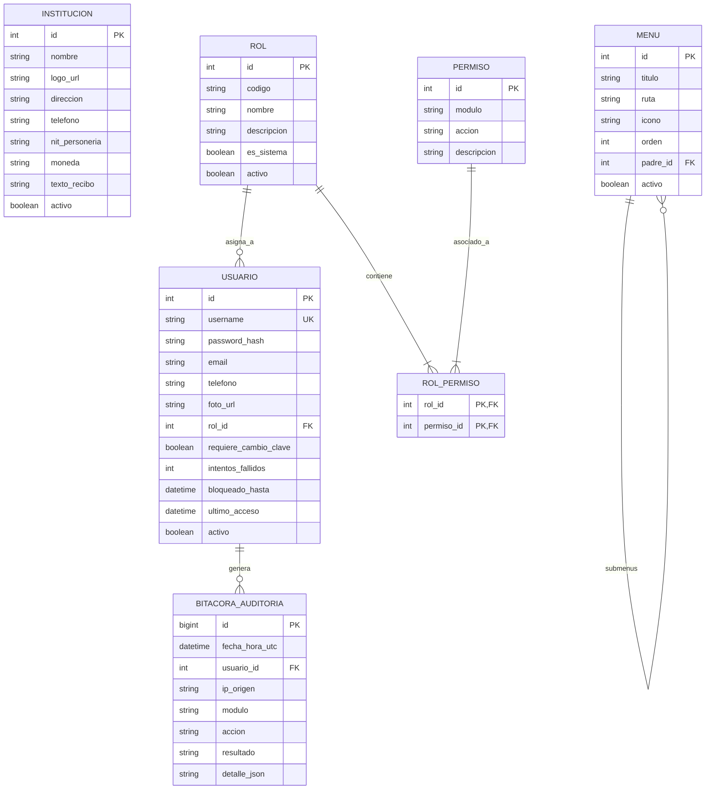

# Feature Specification: Fase 1 — Configuración Institucional, Roles, Permisos y Seguridad

**Feature Branch**: `001-configuracion-seguridad`  
**Created**: 28 de Octubre de 2026  
**Status**: Draft (Listo para revisión)  
**Input**: Fase 1 del Orden Recomendado de Implementación (Secciones 3.2, 3.3, 3.4, 3.5 y 12 del documento fuente "SISTEMA DE ADMINISTRACIÓN.docx")  
**Constitución de Referencia**: [.specify/memory/constitution.md](../../.specify/memory/constitution.md) (Principios P6, P7, P9, P13, P14)

---

## 1. User Scenarios & Testing *(Prioritized User Journeys)*

### User Story 1 — Autenticación Segura y Forzado de Cambio de Clave Temporal (Priority: P1)

Como usuario del sistema (cajero, lector, administrador o socio) que accede por primera vez con una credencial temporal proporcionada por la administración, necesito iniciar sesión de forma segura y establecer de inmediato mi propia contraseña privada para garantizar que solo yo tenga acceso a mi cuenta.

**Why this priority**: Es el punto de entrada primario a todo el sistema. Protege la identidad de los usuarios y cumple el mandato constitucional de no permitir contraseñas permanentes inseguras (prohibición del carnet como clave definitiva).

**Independent Test**: Puede probarse de forma totalmente autónoma creando un usuario con clave temporal, iniciando sesión, verificando que el sistema bloquea cualquier otra acción hasta que se cambie la clave por una que cumpla los requisitos de complejidad, y comprobando que posteriores ingresos funcionan exclusivamente con la nueva contraseña.

**Acceptance Scenarios**:
1. **Given** un usuario con contraseña temporal recién creada, **When** introduce su usuario y contraseña temporal en `/login`, **Then** el sistema autentica la sesión, no permite navegar a ninguna otra ruta y redirige forzosamente a `/perfil/cambiar-contrasena` con un mensaje indicando que debe establecer su clave personal.
2. **Given** un usuario en la pantalla de cambio forzado de contraseña, **When** intenta ingresar una contraseña que coincide con su número de carnet de identidad o que tiene menos de 8 caracteres, **Then** el sistema rechaza el cambio y explica los requisitos de seguridad (mínimo 8 caracteres, combinación de letras y números).
3. **Given** un usuario que introduce correctamente su nueva contraseña y su confirmación, **When** envía el formulario, **Then** el sistema actualiza la credencial cifrada, desactiva la bandera de cambio forzado, registra el evento en auditoría y redirige al panel correspondiente a su rol.
4. **Given** un usuario que falla consecutivamente 5 intentos de inicio de sesión, **When** realiza el 6to intento fallido, **Then** el sistema bloquea temporalmente la cuenta por 15 minutos e informa al usuario sin revelar si el error fue el nombre de usuario o la clave.

---

### User Story 2 — Parametrización Institucional Dinámica (Priority: P1)

Como Administrador de la organización de agua, necesito registrar y actualizar los datos generales de la institución (nombre, logotipo, dirección, teléfono, datos tributarios/personería, moneda y periodos de cobro) para que aparezcan automáticamente en la cabecera del sistema, proformas, recibos oficiales y reportes, sin requerir cambios en el código fuente.

**Why this priority**: La entidad necesita personalizar sus comprobantes y pantallas oficiales desde el primer día. Cumple con el Principio Constitucional P9 (Configuración Controlada).

**Independent Test**: Puede probarse accediendo a `/configuracion/institucion`, modificando el nombre de la cooperativa, subiendo un nuevo logotipo y guardando; verificando que la interfaz general, el título y los comprobantes reflejan de inmediato los nuevos valores.

**Acceptance Scenarios**:
1. **Given** un usuario con rol de Administrador General, **When** navega a `/configuracion/institucion`, **Then** visualiza un formulario con el nombre institucional, logotipo actual, teléfono de contacto, dirección física, NIT/personería jurídica, moneda (`Bs`) y fecha base de facturación.
2. **Given** el Administrador modifica el nombre a "Comité de Agua Potable San Juan" y sube un archivo PNG como logotipo, **When** guarda los cambios, **Then** el sistema valida que la imagen sea válida (PNG/JPG < 2MB), persiste los datos y actualiza inmediatamente la barra de navegación superior con el nuevo logo y nombre.
3. **Given** un usuario sin rol de Administrador (ej. Cajero o Lector), **When** intenta ingresar directamente por URL a `/configuracion/institucion`, **Then** el servidor deniega el acceso con código HTTP 403 (Prohibido) y muestra un mensaje amigable de permisos insuficientes.

---

### User Story 3 — Matriz de Roles y Permisos RBAC Verificada en Servidor (Priority: P1)

Como Administrador General, necesito asignar permisos granulares (Ver, Crear, Modificar, Anular, Imprimir, Exportar, Aprobar, Validar, Migrar) a cada rol de la organización para que cada funcionario acceda estrictamente a las funciones que le competen según su cargo.

**Why this priority**: Es la base del control interno institucional, la separación de funciones financieras y el Principio P7 (Seguridad por Defecto).

**Independent Test**: Se asigna al rol "Cajero" únicamente el permiso de "Crear" y "Ver" en el módulo de caja, revocando "Anular" y "Exportar". Se verifica que las opciones no aparecen en pantalla y que cualquier petición HTTP directa a endpoints restringidos es bloqueada en el servidor.

**Acceptance Scenarios**:
1. **Given** el Administrador en `/administracion/roles`, **When** consulta la matriz de permisos para el rol "Encargado de Lecturas", **Then** visualiza activos únicamente los permisos de lectura, captura y proforma, con accesos denegados para cobranzas y anulación de recibos.
2. **Given** un usuario autenticado con rol "Encargado de Lecturas", **When** envía una petición mutante maliciosa (POST/PUT) hacia una ruta de cobranza o anulación, **Then** el servidor intercepta la petición, verifica los permisos en el token/sesión y rechaza la operación con HTTP 403, registrando un intento no autorizado en auditoría.
3. **Given** el Administrador crea un nuevo rol personalizado (ej. "Técnico de Redes"), **When** selecciona los módulos y acciones permitidas y guarda, **Then** el rol queda disponible de inmediato para ser asignado a usuarios del sistema.

---

### User Story 4 — Gestión y Navegación Dinámica de Menús (Priority: P2)

Como usuario del sistema, necesito ver un menú de navegación claro, estructurado por grupos funcionales y filtrado automáticamente según mis permisos, para encontrar rápidamente mis tareas sin confusión.

**Why this priority**: Garantiza la usabilidad (Principio P12) y asegura que los socios y operadores vean exclusivamente lo que necesitan.

**Independent Test**: Iniciar sesión con diferentes usuarios (Administrador, Cajero, Socio) y comprobar que la barra lateral renderiza únicamente los grupos y submenús correspondientes a sus roles asignados.

**Acceptance Scenarios**:
1. **Given** un Socio que inicia sesión en el portal, **When** carga su panel, **Then** su menú únicamente muestra las opciones: "Inicio", "Mis Medidores", "Mis Lecturas", "Mis Deudas", "Mis Recibos" y "Mi Perfil", sin mostrar ningún módulo administrativo ni de caja.
2. **Given** el Administrador en `/administracion/menus`, **When** desactiva temporalmente un submenú o cambia su orden de visualización, **Then** los usuarios afectados ven reflejado el cambio de inmediato en su siguiente navegación.
3. **Given** un submenú vinculado a registros históricos, **When** el Administrador intenta eliminarlo físicamente, **Then** el sistema impide el borrado físico y solo permite su desactivación lógica.

---

### User Story 5 — Creación y Enrolamiento de Usuarios Administrativos (Priority: P2)

Como Responsable Administrativo, necesito dar de alta cuentas de usuario para el personal de oficina y campo, generando nombres de usuario estandarizados (`mlopez`) y entregándoles un talón de credencial temporal de un solo uso para que activen su acceso.

**Why this priority**: Permite incorporar al personal operativo bajo un protocolo formal de entrega de credenciales.

**Independent Test**: Dar de alta a un usuario "María López", verificar que el sistema sugiere `mlopez` (o `mlopez1` si ya existe), genera una contraseña aleatoria de 10 caracteres, emite un comprobante de activación imprimible y registra el alta en auditoría.

**Acceptance Scenarios**:
1. **Given** el formulario de nuevo usuario en `/administracion/usuarios`, **When** se introducen los nombres "Juan" y apellido "Pérez", **Then** el sistema sugiere automáticamente el nombre de usuario `jperez`.
2. **Given** que ya existe un usuario `jperez` registrado en el sistema, **When** se introduce otro "José Pérez", **Then** el sistema detecta la colisión y genera una alternativa no repetida (ej. `jperez2` o `jose.perez`), impidiendo cuentas duplicadas.
3. **Given** la creación confirmada del usuario, **When** se guarda el registro, **Then** el sistema genera una contraseña temporal de alta entropía, marca la cuenta con `requiere_cambio_clave = TRUE` y muestra una ventana emergente para imprimir la ficha de entrega confidencial al usuario.

---

### User Story 6 — Autoservicio de Perfil de Usuario (Priority: P3)

Como usuario autenticado, necesito acceder a mi sección "Mi Perfil" para consultar mis datos básicos, actualizar mi teléfono de contacto, subir una fotografía de avatar y cambiar mi contraseña voluntariamente en cualquier momento.

**Why this priority**: Facilita la autogestión de credenciales y personaliza la experiencia del usuario.

**Independent Test**: Ingresar a `/perfil`, actualizar el teléfono, subir una foto JPG de perfil, cambiar la contraseña actual por una nueva y verificar que la sesión sigue activa y los datos actualizados.

**Acceptance Scenarios**:
1. **Given** un usuario en `/perfil`, **When** solicita cambiar su contraseña voluntariamente, **Then** el sistema le solicita: Contraseña Actual, Nueva Contraseña y Confirmación de Nueva Contraseña.
2. **Given** el usuario ingresa su contraseña actual incorrecta, **When** envía el formulario, **Then** el sistema rechaza la operación sin alterar la contraseña y alerta del error.
3. **Given** un usuario sube una fotografía para su perfil, **When** el archivo es un formato no admitido (ej. ejecutable o PDF), **Then** el sistema rechaza la carga y especifica que solo se aceptan imágenes JPG o PNG de hasta 2 MB.

---

### User Story 7 — Pista de Auditoría de Seguridad Inalterable (Priority: P1)

Como Auditor o Administrador General, necesito consultar una bitácora cronológica inmutable de todas las acciones de seguridad y configuración realizadas en el sistema (inicios de sesión, fallos de autenticación, cambios de roles, creación de usuarios), con filtros por fecha, usuario y tipo de evento, para asegurar la rendición de cuentas.

**Why this priority**: Es el pilar de la rendición de cuentas, detección de intrusiones y cumplimiento del Principio Constitucional P6.

**Independent Test**: Realizar un inicio de sesión fallido, un cambio de rol y un cambio de contraseña; luego ingresar a la vista de auditoría como Administrador y verificar que los tres eventos figuran con timestamp exacto, usuario, IP y detalle sin exponer contraseñas.

**Acceptance Scenarios**:
1. **Given** cualquier operación de seguridad realizada en el sistema, **When** se persiste el evento en la bitácora de auditoría, **Then** se registran: ID de usuario, IP de origen, fecha/hora en UTC, categoría del evento, entidad afectada y resultado (Éxito / Fallo).
2. **Given** un evento de inicio de sesión o cambio de contraseña, **When** se inspecciona el registro de auditoría en base de datos o en pantalla, **Then** se verifica que en ningún campo existe texto en claro de contraseñas, hashes, tokens de sesión ni secretos.
3. **Given** la tabla de auditoría, **When** cualquier usuario (incluso el Administrador) intenta editar o borrar un registro de la bitácora, **Then** el sistema y la base de datos rechazan la instrucción (`tabla de solo inserción / Append-Only`).

---

## 2. Edge Cases & Boundary Conditions

- **Colisiones de Nombres de Usuario:** ¿Qué ocurre si se registran usuarios con nombres y apellidos idénticos? El sistema añade un sufijo numérico incremental determinístico (`mlopez`, `mlopez1`, `mlopez2`) y permite al administrador ajustar el alias antes de guardar.
- **Sesiones Concurrentes:** Si un cajero inicia sesión en una terminal, ¿puede abrir otra sesión en otra máquina con el mismo usuario? El sistema invalidará la sesión previa o notificará la existencia de una sesión concurrente para evitar fraudes en caja.
- **Expiración de Sesión:** Si un usuario deja la pantalla abierta sin actividad durante 30 minutos, el sistema destruye la sesión en el servidor y redirige al login solicitando credenciales nuevamente.
- **Desconexión Durante Guardado Institucional:** Si la conexión se interrumpe mientras se sube el logotipo, la transacción se cancela atómicamente; no quedan archivos huérfanos ni configuraciones corruptas.
- **Intentos de Escalación de Privilegios:** Si un usuario autenticado intenta manipular los campos ocultos o la carga útil (payload JSON) enviando `rol_id: 1` (Admin) en su propio perfil, el servidor ignora el campo y solo procesa los atributos permitidos por el esquema de entrada (*Mass Assignment Protection*).

---

## 3. Requirements *(Functional & Non-Functional)*

### Functional Requirements

- **FR-001**: El sistema DEBE autenticar usuarios mediante identificador único (username) y contraseña cifrada, rechazando credenciales inválidas sin revelar cuál de los dos datos falló.
- **FR-002**: El sistema DEBE almacenar contraseñas exclusivamente mediante funciones hash adaptativas de alta seguridad (Argon2id o bcrypt con costo $\ge 12$).
- **FR-003**: El sistema DEBE prohibir el uso del Carnet de Identidad como contraseña permanente. Si se asigna como clave inicial, DEBE obligar su cambio en el primer inicio de sesión.
- **FR-004**: El sistema DEBE bloquear temporalmente una cuenta tras 5 intentos fallidos consecutivos de autenticación durante una ventana de 15 minutos.
- **FR-005**: El sistema DEBE permitir al Administrador configurar en base de datos: Nombre de la Organización, Logo, Dirección, Teléfono, NIT/Personería, Moneda (Bs) y Textos legales de recibos.
- **FR-006**: El sistema DEBE proveer un módulo de administración de Roles con asignación granular de permisos por módulo y por tipo de acción (`ver`, `crear`, `editar`, `anular`, `imprimir`, `exportar`, `aprobar`, `validar`).
- **FR-007**: El sistema DEBE verificar los permisos de autorización en el servidor para cada solicitud HTTP protegida; la ausencia de un botón en la interfaz NUNCA sustituye la validación en backend.
- **FR-008**: El sistema DEBE generar dinámicamente el árbol de navegación (menús y submenús) filtrado estrictamente por los permisos del rol del usuario activo.
- **FR-009**: El sistema DEBE generar nombres de usuario sugeridos basados en la inicial del nombre y el primer apellido, resolviendo colisiones mediante sufijos únicos.
- **FR-010**: El sistema DEBE registrar en una bitácora inalterable (Append-Only) todos los eventos de autenticación, cambios de configuración, gestión de usuarios y excepciones de autorización.
- **FR-011**: Los registros de auditoría NUNCA DEBEN contener contraseñas en claro, tokens de recuperación ni datos confidenciales.
- **FR-012**: El sistema DEBE permitir a los usuarios consultar y actualizar su perfil personal (teléfono, fotografía) y cambiar voluntariamente su contraseña validando la anterior.

### Non-Functional Requirements & Security Constraints

- **NFR-001 (Protección OWASP):** Todas las consultas a base de datos deben ser parametrizadas (prevención SQLi); todas las salidas deben escapar caracteres especiales (prevención XSS); todas las peticiones POST/PUT/DELETE deben validar un token antifalsificación (CSRF).
- **NFR-002 (Tiempos de Respuesta):** La verificación de autenticación y autorización no debe añadir una sobrecarga superior a 50 milisegundos por petición.
- **NFR-003 (Diseño Adaptable):** Las pantallas de login, perfil, configuración y menús deben ser 100% responsivas, funcionando fluidamente en pantallas de escritorio, tabletas y teléfonos móviles.
- **NFR-004 (Cero Borrado Físico):** Las entidades de configuración, roles y usuarios implementarán borrado lógico mediante banderas de estado (`activo = false`).

---

## 4. Key Entities & Domain Concepts

---

## 5. Success Criteria *(Measurable Outcomes)*

- **SC-001**: El 100% de los nuevos usuarios dados de alta son forzados a cambiar su clave temporal en su primer ingreso antes de poder realizar cualquier otra acción.
- **SC-002**: Ninguna petición maliciosa con permisos revocados puede acceder a endpoints de administración o cobros (100% de efectividad en pruebas de penetración RBAC en servidor).
- **SC-003**: Cero contraseñas o secretos registrados en la tabla de auditoría durante las pruebas de seguridad.
- **SC-004**: Los cambios en los datos institucionales (nombre, logo, teléfono) se propagan y visualizan en todas las pantallas en un tiempo inferior a 1 segundo tras guardar.
- **SC-005**: El tiempo de respuesta del login y cálculo de menú dinámico es inferior a 200 ms bajo concurrencia normal.

---

## 6. Assumptions & Dependencies

- **A-001**: La organización proveerá el logotipo en formato digital (PNG o JPG) de resolución adecuada para recibos impresos y pantalla.
- **A-002**: Los navegadores utilizados por el personal soportan cookies seguras HTTP-only y JavaScript moderno para la interfaz adaptable.
- **A-003**: La selección final del motor relacional (PostgreSQL) y el framework backend soportará transacciones ACID y bibliotecas criptográficas estándar para Argon2id/bcrypt.

