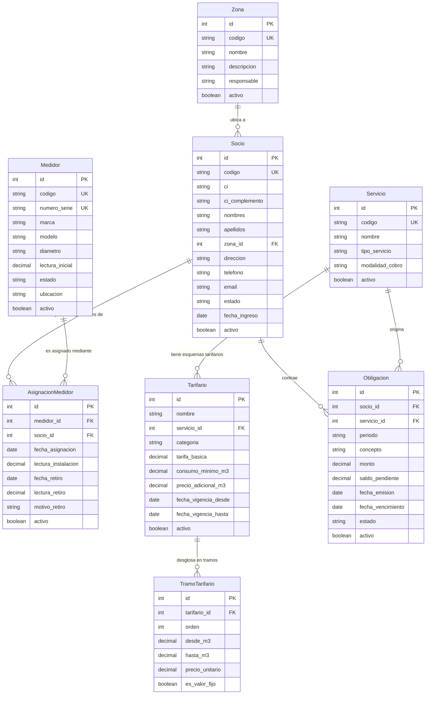

# Modelo de Datos: 002-datos-maestros

> **Feature:** Datos Maestros (Zonas, Socios, Servicios, Medidores y Tarifario)  
> **Fase SDD:** Fase 1 — Modelo de Datos y Restricciones de Integridad  
> **Fecha:** Octubre 2026  

---

## 1. Diagrama Entidad-Relación Conceptual

---

## 2. Definición Detallada de Modelos y Restricciones

### 2.1. Aplicación `apps.socios`

#### Modelo `Zona`
- Hereda de: `BaseAuditableModel` (`creado_en`, `actualizado_en`, `activo`).
- **Campos:**
  - `codigo`: `CharField(max_length=20, unique=True, db_index=True)` — Código alfanumérico identificador (ej. `ZON-NORTE`).
  - `nombre`: `CharField(max_length=100)` — Nombre oficial de la zona o sector.
  - `descripcion`: `TextField(blank=True, default='')` — Delimitación física o notas de ubicación.
  - `responsable`: `CharField(max_length=150, blank=True, default='')` — Nombre del delegado vecinal o responsable de sector.
  - `observaciones`: `TextField(blank=True, default='')`.
- **Restricciones y Validaciones:**
  - `clean()`: Bloqueo de código en minúsculas (se almacena siempre en mayúsculas sin espacios extremos).
  - Prohibición de `DELETE` físico: sobrescribe `delete()` lanzando excepción protegida si existen socios o medidores vinculados.

#### Modelo `Socio`
- Hereda de: `BaseAuditableModel`.
- **Campos:**
  - `codigo`: `CharField(max_length=20, unique=True, db_index=True)` — Identificador único correlativo (ej. `SOC-0001`).
  - `ci`: `CharField(max_length=20, db_index=True)` — Cédula de Identidad boliviana.
  - `ci_complemento`: `CharField(max_length=5, blank=True, default='')` — Complemento alfanumérico para desempate de homónimos (ej. `1A`, `LP`).
  - `nombres`: `CharField(max_length=100)` — Nombres de pila del titular.
  - `apellidos`: `CharField(max_length=100)` — Apellidos paterno y materno.
  - `zona`: `ForeignKey(Zona, on_delete=models.PROTECT, related_name='socios')` — Zona obligatoria donde radica el socio.
  - `direccion`: `CharField(max_length=255)` — Dirección detallada o descripción del predio.
  - `telefono`: `CharField(max_length=25, blank=True, default='')` — Número celular o fijo de contacto.
  - `email`: `EmailField(blank=True, default='')` — Correo electrónico para futuras notificaciones.
  - `fecha_ingreso`: `DateField(default=timezone.now)` — Fecha oficial de afiliación a la organización.
  - `estado`: `CharField(max_length=20, choices=EstadoSocio.choices, default=EstadoSocio.ACTIVO)`:
    - `ACTIVO`: En pleno ejercicio de sus derechos y obligaciones.
    - `INACTIVO`: Servicio temporalmente no utilizado, conserva deudas (R-DOM-05).
    - `SUSPENDIDO`: Corte temporal por mora o sanción comunitaria.
    - `RETIRADO`: Baja administrativa; registros históricos preservados intactos.
  - `observaciones`: `TextField(blank=True, default='')`.
- **Restricciones de Integridad en Base de Datos:**
  - `UniqueConstraint(fields=['ci', 'ci_complemento'], name='unique_socio_ci_complemento')` (R-DOM-01).

---

### 2.2. Aplicación `apps.servicios`

#### Modelo `Servicio`
- Hereda de: `BaseAuditableModel`.
- **Campos:**
  - `codigo`: `CharField(max_length=20, unique=True, db_index=True)` (ej. `AGUA`, `MEMBRESIA`, `BASURA`).
  - `nombre`: `CharField(max_length=100)` (ej. `Servicio de Agua Potable`).
  - `descripcion`: `TextField(blank=True, default='')`.
  - `tipo_servicio`: `CharField(max_length=30, choices=TipoServicio.choices, default=TipoServicio.AGUA_POTABLE)`:
    - `AGUA_POTABLE`
    - `MEMBRESIA`
    - `ALCANTARILLADO`
    - `RECOJO_BASURA`
    - `OTRO`
  - `modalidad_cobro`: `CharField(max_length=30, choices=ModalidadCobro.choices)`:
    - `LECTURA_VOLUMETRICA`: Consumo medido por diferencia de lecturas ($m^3$).
    - `CUOTA_FIJA_MENSUAL`: Importe periódico constante.
    - `PAGO_UNICO_MEMBRESIA`: Generación al registrar al socio nuevo (R-DOM-13).
    - `EVENTUAL`: Cobro por demanda (reconexión, inspección).

#### Modelo `Tarifario`
- Hereda de: `BaseAuditableModel`.
- **Campos:**
  - `nombre`: `CharField(max_length=150)` (ej. `Tarifario Doméstico Base 2026`).
  - `servicio`: `ForeignKey(Servicio, on_delete=models.PROTECT, related_name='tarifarios')`.
  - `categoria`: `CharField(max_length=30, choices=CategoriaTarifa.choices, default=CategoriaTarifa.DOMESTICO)`:
    - `DOMESTICO`, `COMERCIAL`, `INDUSTRIAL`, `SOCIAL`.
  - `tarifa_basica`: `DecimalField(max_digits=12, decimal_places=2, default=0.00)` — Importe base fijo en Bs.
  - `consumo_minimo_m3`: `DecimalField(max_digits=10, decimal_places=2, default=0.00)` — Volumen incluido en la tarifa básica.
  - `precio_adicional_m3`: `DecimalField(max_digits=12, decimal_places=2, default=0.00)` — Precio unitario por $m^3$ que excede el consumo mínimo.
  - `fecha_vigencia_desde`: `DateField(db_index=True)` — Fecha inicio de vigencia de esta tarifa.
  - `fecha_vigencia_hasta`: `DateField(null=True, blank=True, db_index=True)` — Nulo si se encuentra actualmente vigente.
- **Regla de Negocio R-DOM-10:**
  - Las tarifas no aplican retroactivamente sobre obligaciones generadas en periodos anteriores a su `fecha_vigencia_desde`.

#### Modelo `TramoTarifario`
- **Campos:**
  - `tarifario`: `ForeignKey(Tarifario, on_delete=models.CASCADE, related_name='tramos')`.
  - `orden`: `PositiveSmallIntegerField(default=1)`.
  - `desde_m3`: `DecimalField(max_digits=10, decimal_places=2)`.
  - `hasta_m3`: `DecimalField(max_digits=10, decimal_places=2, null=True, blank=True)` — Nulo indica tramo abierto ($\ge \text{desde\_m3}$).
  - `precio_unitario`: `DecimalField(max_digits=12, decimal_places=2)`.
  - `es_valor_fijo`: `BooleanField(default=False)` — Permite modelar tarifas escalonadas de valor total fijo por tramo (anomalía de 16 $m^3$ de la fuente).

#### Modelo `Obligacion` (Cuentas por Cobrar Devengadas)
- Hereda de: `BaseAuditableModel`.
- Representa cualquier cuenta por cobrar exigible al socio: membresía inicial, consumo mensual de agua, cuotas fijas o conceptos eventuales.
- **Campos:**
  - `socio`: `ForeignKey('socios.Socio', on_delete=models.PROTECT, related_name='obligaciones')`.
  - `servicio`: `ForeignKey(Servicio, on_delete=models.PROTECT, related_name='obligaciones')`.
  - `periodo`: `CharField(max_length=15, db_index=True)` — Formato `YYYY-MM` para agua mensual, o `MEMBRESIA-YYYY` / `UNICO` para conceptos únicos.
  - `concepto`: `CharField(max_length=200)` — Detalle descriptivo (ej. `Derecho de Membresía de Afiliación`).
  - `monto`: `DecimalField(max_digits=12, decimal_places=2)` — Monto total de la obligación en Bs.
  - `saldo_pendiente`: `DecimalField(max_digits=12, decimal_places=2)` — Saldo por cobrar (inicialmente igual a `monto`).
  - `fecha_emision`: `DateField(default=timezone.now)`.
  - `fecha_vencimiento`: `DateField()` — Calculada determinísticamente según R-DOM-14.
  - `estado`: `CharField(max_length=20, choices=EstadoObligacion.choices, default=EstadoObligacion.PENDIENTE)`:
    - `PENDIENTE`: Por cobrar en caja.
    - `PAGADA`: Cobrada en su totalidad mediante recibo de cobranza.
    - `ANULADA`: Anulada formalmente por autoridad competente.
- **Restricción de Idempotencia (R-DOM-12, R-DOM-13):**
  - `UniqueConstraint(fields=['socio', 'servicio', 'periodo'], name='unique_obligacion_socio_servicio_periodo')`.

---

### 2.3. Aplicación `apps.medidores`

#### Modelo `Medidor`
- Hereda de: `BaseAuditableModel`.
- **Campos:**
  - `codigo`: `CharField(max_length=30, unique=True, db_index=True)` — Código interno de activo (ej. `MED-0001`).
  - `numero_serie`: `CharField(max_length=50, unique=True, db_index=True)` — Serie de fábrica grabada en el reloj.
  - `marca`: `CharField(max_length=50, blank=True, default='')`.
  - `modelo`: `CharField(max_length=50, blank=True, default='')`.
  - `diametro`: `CharField(max_length=20, default='1/2"')` — Diámetro nominal de la conexión.
  - `lectura_inicial`: `DecimalField(max_digits=10, decimal_places=2, default=0.00)` — Calibración inicial al salir de almacén.
  - `ubicacion`: `CharField(max_length=255, blank=True, default='')` — Referencia física de la caja o nicho del medidor.
  - `estado`: `CharField(max_length=20, choices=EstadoMedidor.choices, default=EstadoMedidor.DISPONIBLE)`:
    - `DISPONIBLE`: En almacén, listo para ser asignado.
    - `INSTALADO`: Asignado a un socio y midiendo consumo activo.
    - `MANTENIMIENTO`: Retirado para calibración o reparación.
    - `RETIRADO`: Retirado definitivamente de la red.
    - `DE_BAJA`: Obsoleto o destruido físicamente.
  - `observaciones`: `TextField(blank=True, default='')`.

#### Modelo `AsignacionMedidor`
- Hereda de: `BaseAuditableModel`.
- Gestiona la asignación histórica y vigente de un medidor físico a un socio titular.
- **Campos:**
  - `medidor`: `ForeignKey(Medidor, on_delete=models.PROTECT, related_name='asignaciones')`.
  - `socio`: `ForeignKey('socios.Socio', on_delete=models.PROTECT, related_name='asignaciones')`.
  - `fecha_asignacion`: `DateField(default=timezone.now)`.
  - `lectura_instalacion`: `DecimalField(max_digits=10, decimal_places=2)`.
  - `fecha_retiro`: `DateField(null=True, blank=True)`.
  - `lectura_retiro`: `DecimalField(max_digits=10, decimal_places=2, null=True, blank=True)`.
  - `motivo_retiro`: `CharField(max_length=200, blank=True, default='')`.
  - `activo`: `BooleanField(default=True, db_index=True)` — Indica si la asignación está vigente.
- **Restricciones de Integridad (R-DOM-03, R-DOM-04):**
  - `UniqueConstraint(fields=['medidor'], condition=Q(activo=True), name='unique_asignacion_activa_por_medidor')`: Garantiza que ningún medidor físico esté asignado a dos socios simultáneamente.
  - Validación de retiro: `lectura_retiro` no puede ser inferior a `lectura_instalacion`.

