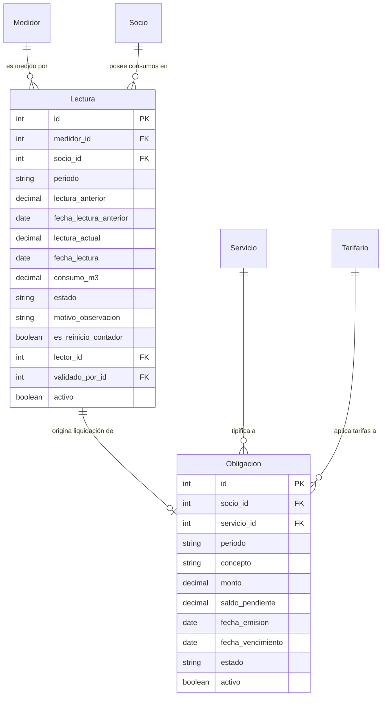

# Modelo de Datos: 003-consumo-lecturas-calculo

> **Feature:** Consumo, Lecturas Mensuales, Proformas y Cálculo de Obligaciones  
> **Fase SDD:** Fase 1 — Modelo de Datos y Restricciones de Integridad  
> **Fecha:** Octubre 2026  

---

## 1. Diagrama Entidad-Relación Conceptual



---

## 2. Definición Detallada del Modelo `Lectura`

### Modelo `apps.consumo.models.Lectura`
- Hereda de: `BaseAuditableModel` (`activo`, `created_at`, `updated_at`).
- **Campos:**
  - `medidor`: `ForeignKey('medidores.Medidor', on_delete=models.PROTECT, related_name='lecturas')` — Medidor físico sobre el que se realiza la toma.
  - `socio`: `ForeignKey('socios.Socio', on_delete=models.PROTECT, related_name='lecturas')` — Socio titular asignado en el periodo de lectura.
  - `periodo`: `CharField(max_length=7, db_index=True)` — Formato canónico `YYYY-MM` (ej. `2026-10`).
  - `lectura_anterior`: `DecimalField(max_digits=10, decimal_places=2)` — Última lectura válida anterior en $m^3$.
  - `fecha_lectura_anterior`: `DateField(null=True, blank=True)` — Fecha en que se tomó la lectura anterior.
  - `lectura_actual`: `DecimalField(max_digits=10, decimal_places=2)` — Lectura tomada en el periodo presente en $m^3$.
  - `fecha_lectura`: `DateField(default=timezone.now)` — Fecha oficial de la toma de lectura en campo.
  - `consumo_m3`: `DecimalField(max_digits=10, decimal_places=2)` — Consumo volumétrico resultante ($\text{Lectura Actual} - \text{Lectura Anterior}$ o fórmula de rollover).
  - `estado`: `CharField(max_length=20, choices=EstadoLectura.choices, default=EstadoLectura.VALIDADA)`:
    - `VALIDADA`: Aprobada para proceso de facturación automática.
    - `OBSERVADA`: Bloqueada por salto anómalo o lectura menor a la anterior (R-DOM-07, P10).
    - `CORREGIDA`: Rectificada formalmente por un supervisor con motivo registrado.
    - `ANULADA`: Descartada administrativamente (se conserva por auditoría P5).
  - `motivo_observacion`: `CharField(max_length=255, blank=True, default='')` — Detalle del problema detectado.
  - `es_reinicio_contador`: `BooleanField(default=False)` — Bandera que indica si el medidor dio la vuelta a cero (*rollover*).
  - `observaciones`: `TextField(blank=True, default='')` — Notas de campo del lector (ej. nicho con candado, perro bravo).
  - `lector`: `ForeignKey(settings.AUTH_USER_MODEL, on_delete=models.SET_NULL, null=True, blank=True, related_name='lecturas_tomadas')` — Operador que capturó el dato.
  - `validado_por`: `ForeignKey(settings.AUTH_USER_MODEL, on_delete=models.SET_NULL, null=True, blank=True, related_name='lecturas_validadas')` — Supervisor que levantó la observación o aprobó la corrección.
  - `fecha_validacion`: `DateTimeField(null=True, blank=True)`.

---

## 3. Restricciones de Base de Datos y Validaciones

1. **Unicidad de Lectura Definitiva (R-DOM-08):**
   ```python
   models.UniqueConstraint(
       fields=['medidor', 'periodo'],
       condition=models.Q(activo=True),
       name='unique_lectura_activa_por_medidor_periodo'
   )
   ```
   Garantiza a nivel de motor SQL que jamás coexistan dos lecturas activas para el mismo medidor en el mismo periodo `YYYY-MM`.

2. **Validación de Monotonicidad en `clean()` (R-DOM-07):**
   - Si no es `es_reinicio_contador` y `lectura_actual < lectura_anterior`:
     - El modelo asigna automáticamente `estado = EstadoLectura.OBSERVADA`.
     - Establece `motivo_observacion = f"Lectura actual ({lectura_actual} m³) es menor a la anterior ({lectura_anterior} m³)"`.
     - Establece `consumo_m3 = Decimal('0.00')`.

3. **Cero Borrado Físico (P5):**
   - Sobrescritura de `delete()` para rechazar llamadas a `DELETE` físico: lanza `ValidationError("No se permite eliminar físicamente lecturas registradas. Utilice la anulación lógica o corrección autorizada (Principio P5).")`.

