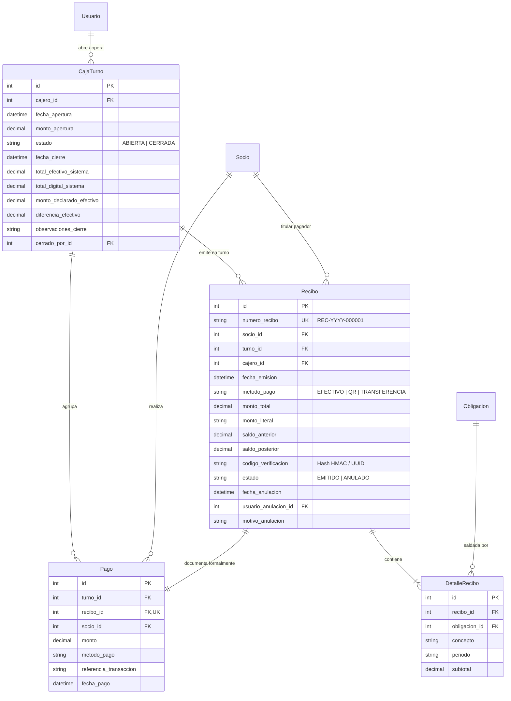

# Modelo de Datos: Fase 4 - Caja, Cobros, Recibos y Turnos (004-caja-cobros-recibos)

## 1. Diagrama Entidad-Relación (Mermaid)

---

## 2. Definición Detallada de Entidades

### 2.1. `CajaTurno` (apps.caja.models.CajaTurno)
Representa la sesión de trabajo y custodia de efectivo de un cajero durante su jornada.
- `cajero`: `ForeignKey('seguridad.Usuario', on_delete=PROTECT, related_name='turnos_caja')`
- `fecha_apertura`: `DateTimeField(default=timezone.now)`
- `monto_apertura`: `DecimalField(max_digits=12, decimal_places=2, default=0.00)` (Fondo de cambio).
- `estado`: `CharField(max_length=20, choices=['ABIERTA', 'CERRADA'], default='ABIERTA', db_index=True)`
- `fecha_cierre`: `DateTimeField(null=True, blank=True)`
- `total_efectivo_sistema`: `DecimalField(max_digits=12, decimal_places=2, default=0.00)`
- `total_digital_sistema`: `DecimalField(max_digits=12, decimal_places=2, default=0.00)`
- `monto_declarado_efectivo`: `DecimalField(max_digits=12, decimal_places=2, null=True, blank=True)`
- `diferencia_efectivo`: `DecimalField(max_digits=12, decimal_places=2, default=0.00)`
- `observaciones_cierre`: `TextField(blank=True, default='')`
- `cerrado_por`: `ForeignKey('seguridad.Usuario', on_delete=PROTECT, null=True, blank=True, related_name='turnos_cerrados')`

**Reglas de Validación**:
- Un cajero no puede abrir un nuevo turno si ya tiene uno en estado `ABIERTA`.
- `delete()` bloqueado para garantizar inmutabilidad histórica (P5).

---

### 2.2. `Recibo` (apps.caja.models.Recibo)
Documento oficial y comprobante legal de cobranza emitido al socio.
- `numero_recibo`: `CharField(max_length=30, unique=True, db_index=True)` Formato `REC-{año}-{secuencia:06d}`.
- `socio`: `ForeignKey('socios.Socio', on_delete=PROTECT, related_name='recibos')`
- `turno`: `ForeignKey(CajaTurno, on_delete=PROTECT, related_name='recibos')`
- `cajero`: `ForeignKey('seguridad.Usuario', on_delete=PROTECT, related_name='recibos_cobrados')`
- `fecha_emision`: `DateTimeField(default=timezone.now, db_index=True)`
- `metodo_pago`: `CharField(max_length=20, choices=['EFECTIVO', 'QR', 'TRANSFERENCIA'])`
- `monto_total`: `DecimalField(max_digits=12, decimal_places=2)`
- `monto_literal`: `CharField(max_length=255)` (Ej. "Ciento cincuenta 00/100 Bolivianos").
- `saldo_anterior`: `DecimalField(max_digits=12, decimal_places=2)`
- `saldo_posterior`: `DecimalField(max_digits=12, decimal_places=2)`
- `codigo_verificacion`: `CharField(max_length=64, db_index=True)`
- `estado`: `CharField(max_length=20, choices=['EMITIDO', 'ANULADO'], default='EMITIDO', db_index=True)`
- `fecha_anulacion`: `DateTimeField(null=True, blank=True)`
- `usuario_anulacion`: `ForeignKey('seguridad.Usuario', on_delete=PROTECT, null=True, blank=True, related_name='recibos_anulados')`
- `motivo_anulacion`: `TextField(blank=True, default='')`

**Reglas de Validación**:
- `delete()` lanza `ValidationError` (prohibido borrado físico P5).
- Solo puede anularse si está en estado `EMITIDO` y mediante el servicio autorizado.

---

### 2.3. `DetalleRecibo` (apps.caja.models.DetalleRecibo)
Desglose ítem por ítem de cada obligación liquidada en el recibo.
- `recibo`: `ForeignKey(Recibo, on_delete=CASCADE, related_name='detalles')`
- `obligacion`: `ForeignKey('servicios.Obligacion', on_delete=PROTECT, related_name='detalles_recibo')`
- `concepto`: `CharField(max_length=200)`
- `periodo`: `CharField(max_length=30)`
- `subtotal`: `DecimalField(max_digits=12, decimal_places=2)`

---

### 2.4. `Pago` (apps.caja.models.Pago)
Registro de la transacción financiera que ingresa fondos al turno de caja.
- `turno`: `ForeignKey(CajaTurno, on_delete=PROTECT, related_name='pagos')`
- `recibo`: `OneToOneField(Recibo, on_delete=PROTECT, related_name='pago')`
- `socio`: `ForeignKey('socios.Socio', on_delete=PROTECT, related_name='pagos')`
- `monto`: `DecimalField(max_digits=12, decimal_places=2)`
- `metodo_pago`: `CharField(max_length=20, choices=['EFECTIVO', 'QR', 'TRANSFERENCIA'])`
- `referencia_transaccion`: `CharField(max_length=100, blank=True, default='')`
- `fecha_pago`: `DateTimeField(default=timezone.now)`

