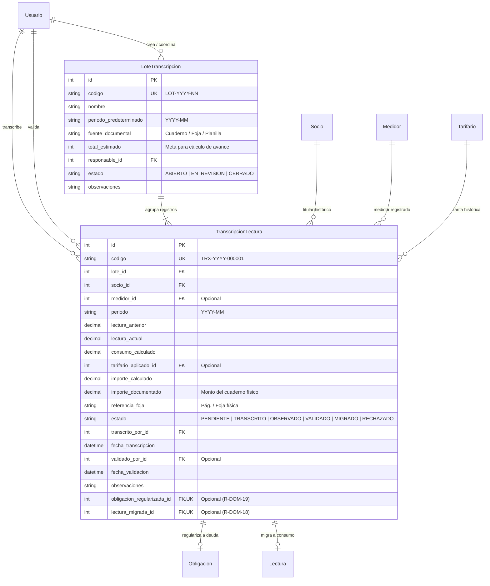

# Modelo de Datos: Fase 5 - Transcripción Histórica y Regularización (005-transcripcion-historica-regularizacion)

## 1. Diagrama Entidad-Relación (Mermaid)

---

## 2. Definición Detallada de Entidades

### 2.1. `LoteTranscripcion` (apps.transcripcion.models.LoteTranscripcion)
Representa la unidad documental física origen de los datos a migrar.
- `codigo`: `CharField(max_length=30, unique=True, db_index=True)`
- `nombre`: `CharField(max_length=150)` (Ej. "Planilla Manuscrita 2024 - Sector Alto")
- `periodo_predeterminado`: `CharField(max_length=30, blank=True, default='')`
- `fuente_documental`: `CharField(max_length=200)` (Ej. "Cuaderno Nº 4 de lecturas, archivo parroquial")
- `total_estimado`: `PositiveIntegerField(default=0)` (Cantidad prevista para cálculo de avance porcentual)
- `responsable`: `ForeignKey('seguridad.Usuario', on_delete=PROTECT, related_name='lotes_transcripcion')`
- `estado`: `CharField(max_length=20, choices=['ABIERTO', 'EN_REVISION', 'CERRADO'], default='ABIERTO')`
- `observaciones`: `TextField(blank=True, default='')`

**Restricciones de Integridad**:
- `delete()` bloqueado para garantizar conservación histórica (Principio P5).

---

### 2.2. `TranscripcionLectura` (apps.transcripcion.models.TranscripcionLectura)
Fila individual capturada de una planilla o cuaderno físico.
- `codigo`: `CharField(max_length=32, unique=True, db_index=True)` Formato `TRX-{año}-{secuencia:06d}`.
- `lote`: `ForeignKey(LoteTranscripcion, on_delete=PROTECT, related_name='registros')`
- `socio`: `ForeignKey('socios.Socio', on_delete=PROTECT, related_name='transcripciones')`
- `medidor`: `ForeignKey('medidores.Medidor', on_delete=PROTECT, null=True, blank=True, related_name='transcripciones')`
- `periodo`: `CharField(max_length=30, db_index=True)` (Formato YYYY-MM)
- `lectura_anterior`: `DecimalField(max_digits=12, decimal_places=2, null=True, blank=True)`
- `lectura_actual`: `DecimalField(max_digits=12, decimal_places=2, null=True, blank=True)`
- `consumo_calculado`: `DecimalField(max_digits=12, decimal_places=2, null=True, blank=True)`
- `tarifario_aplicado`: `ForeignKey('servicios.Tarifario', on_delete=PROTECT, null=True, blank=True)`
- `importe_calculado`: `DecimalField(max_digits=12, decimal_places=2, null=True, blank=True)`
- `importe_documentado`: `DecimalField(max_digits=12, decimal_places=2, null=True, blank=True)` (Monto manuscrito)
- `referencia_foja`: `CharField(max_length=100, blank=True, default='')` (Libro/Página física)
- `estado`: `CharField(max_length=20, choices=['PENDIENTE', 'TRANSCRITO', 'OBSERVADO', 'VALIDADO', 'MIGRADO', 'RECHAZADO'], default='TRANSCRITO', db_index=True)`
- `transcrito_por`: `ForeignKey('seguridad.Usuario', on_delete=PROTECT, related_name='transcripciones_realizadas')`
- `fecha_transcripcion`: `DateTimeField(default=timezone.now)`
- `validado_por`: `ForeignKey('seguridad.Usuario', on_delete=PROTECT, null=True, blank=True, related_name='transcripciones_validadas')`
- `fecha_validacion`: `DateTimeField(null=True, blank=True)`
- `observaciones`: `TextField(blank=True, default='')`
- `obligacion_regularizada`: `OneToOneField('servicios.Obligacion', on_delete=PROTECT, null=True, blank=True, related_name='transcripcion_origen')`
- `lectura_migrada`: `OneToOneField('consumo.Lectura', on_delete=PROTECT, null=True, blank=True, related_name='transcripcion_origen')`

**Reglas de Validación**:
- `consumo_calculado`: Si hay `lectura_anterior` y `lectura_actual`, se calcula `max(0, lectura_actual - lectura_anterior)`.
- Si `lectura_actual < lectura_anterior`, el registro se marca obligatoriamente con advertencia o pasa a `OBSERVADO`.
- `delete()` bloqueado por Principio P5 (usar `RECHAZADO`).

